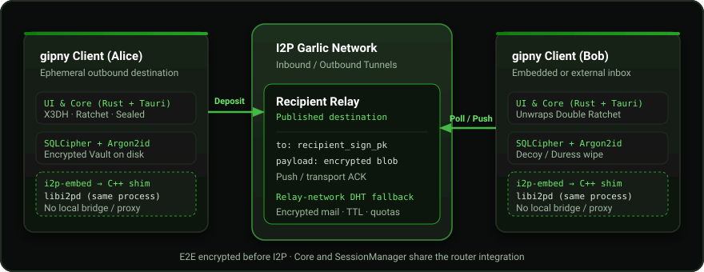

# gipny-i2p

[Русская документация](README.md) · [Downloads](https://github.com/gluckdev/gipny-i2p/releases) · [Security](SECURITY.md) · [Documentation](docs/README.md)

<p align="center"></p>

gipny-i2p is a desktop and Android messenger with end-to-end encryption over
I2P. Exchange contact cards instead of registering a phone number, email address
or server account. Identity keys are created on your device; the client's
outbound I2P destination is regenerated for each session. Router state is a
separate, persistent component.

This is an independent I2P fork of [ri-kont/gipny](https://github.com/ri-kont/gipny),
which used Tor/Arti. The fork embeds the C++ i2pd router through `i2p-embed`,
retains the inherited X3DH/Double Ratchet and encrypted vault, and develops
relay discovery, offline delivery and I2P reliability. The
[migration history](MIGRATION-i2p.md) describes earlier designs; its SAM commands
are historical, not setup instructions for this tree.

## Version and getting started

The source version is **0.4.19**. It includes complete EN/RU localization,
required updater checksums, an atomic group outbox, the Pages project website,
Android JNI/APK staging fixes, deletion for both DM participants, RAM secret
protection, new release targets and the diagnostics policy. See
[GitHub Releases](https://github.com/gluckdev/gipny-i2p/releases) for available
packages, publication dates and status; check the downloaded package's version
against its release notes.

Build/CodeQL badges in the Russian README show the latest run on `main`.
Each check covers its recorded SHA and scenario, rather than every platform
and device. Integration history, [PR #121](https://github.com/gluckdev/gipny-i2p/pull/121),
CI results and their limits are kept in the
[dated integration record](docs/today-2026-10-28.md).

1. Download the installer for your platform from the [releases page](https://github.com/gluckdev/gipny-i2p/releases).
2. Create a local profile and choose a passphrase. No registration server is involved.
3. Wait for the embedded router and tunnels. A cold first start can take minutes.
4. Share your contact card or QR from **My card** through a channel you trust.
5. Add the other person's card, accept their request, and compare key fingerprints through a separate authenticated channel.

Version 0.4.19 exports `gipny:v3:<payload>` cards: **187 ASCII characters**
with a relay and without a name. Both public keys remain complete; full
256-bit b32 hashes replace the long I2P Destinations. Connecting requires
standard I2P lookup/LeaseSet resolution. The checksum detects copying errors
and does not authenticate the owner. Legacy v1/v2 cards are still imported:
[format and limits](docs/contact-cards.md).

No separately installed i2pd, SAM service or local proxy is required. For a new
introduction after restarting, share a fresh card for your built-in relay.
Existing contacts receive authenticated address updates through the protocol.

## Features

The following describes the 0.4.19 source tree. Check each downloaded package's
version for its feature set. Release notes and change history remain in
[docs/releases](docs/releases/) and on [GitHub Releases](https://github.com/gluckdev/gipny-i2p/releases).

### Conversations and files

- Direct conversations and groups, group membership and separate unread counts.
- **In 0.4.19:** each queued group recipient remains pending until their E2E
  acknowledgement, for up to seven days. Only the last expected ACK completes
  delivery. The message, reply/settings, attachment metadata, file offers and
  complete recipient snapshot commit in one transaction before network awaits.
  See [group delivery](docs/group-delivery.md) for crash and retry limits.
- Files and images, a per-chat media/file gallery, clipboard images and saving
  attachments. Files above 128 KiB travel in 192 KiB parts through the recipient's
  relay, with progress, cancellation, reordering and resume after interruption.
  Application memory processing and streamed files have different size limits;
  see [core](core/README.md) and [libcore](libcore/README.md).
- Replies, edits, deletion, forwarding, pinned messages and pinned chats.
- **In 0.4.19:** either DM participant can delete their own or the other
  person's message and attachments for both endpoints. Immutable local numbers
  and permanent placeholders preserve gaps; deletion retries until E2E ACK.
  Clear history and explicit timers use the same protocol, including pinned DMs.
  Old clients and messages missing their original ID have explicit limits:
  [message deletion](docs/message-deletion.md). External copies cannot be recalled.
- Local FTS5 search inside the encrypted application database.
- Typing and sent/delivered indicators, notifications, sound and per-chat muting.
- Inline button keyboards for bots.

### Contacts and interface

- Contact cards containing public identity keys and relay details, without
  phone numbers or email. Requests can be accepted, rejected or blocked.
- Fingerprint verification, verified/bot markers, contact folders and local
  avatars inspired by nineteenth-century Japanese prints.
- Share a QR card; scan a QR with the camera or read one from an image file.
- Reset a contact's encryption session when recovery is needed.
- Light, dark and system themes; layouts for phones, tablets and desktop;
  chat bubbles, timestamps, contact states and collapsible chat navigation.
- Visible boot stages with elapsed time and technical details; the option to
  open chats while networking continues.
- Caffeine mode, with a visible privacy tradeoff for the shorter-tunnel lane;
  channel statistics and online state are based on observed traffic.
- Android back/background handling and connectivity notifications; actual
  device behaviour remains part of platform testing.

### English and Russian

The 0.4.19 localization covers profile setup, chats, contacts, groups,
QR, security, backup, updates, notifications and the agent console. Choose
**English** or **Русский** before unlocking or in **Settings → Language**.
The saved choice is local to the device. Without one, Russian, Belarusian and
Ukrainian browser locales use Russian; other locales use English.

Switching does not restart or lock the profile. Draft text, attachment
references, replies and inline edits remain in memory. Names, messages,
filenames, commands, output and downloaded release notes keep their original
text. Known native errors have English explanations; unknown diagnostics are
preserved. OS permission and picker dialogs use the OS language. See
[localization maintenance](docs/localization.md) and [UI documentation](ui/README.md).

### Privacy, delivery and updates

- X3DH, Double Ratchet and XChaCha20-Poly1305 encrypt content before relays.
  Sealed sender uses `from = [0; 32]` in delivered envelopes; this does not hide
  all authenticated-connection metadata from a relay operator.
- Fixed-size padding buckets; an ordinary payload is limited to approximately
  4 MiB. Large attachments use the chunked-file protocol instead.
- SQLCipher and Argon2id protect application profiles. Multiple profiles,
  encrypted backup/import, a separate decoy and duress/wipe policies are
  supported. In 0.4.19, OS device binding also protects profile keys
  and headless SQLCipher databases; an unavailable provider causes an explicit
  refusal. [Provider limits](docs/device-bound-storage.md).
- **In 0.4.19:** guarded encrypted containers protect idle secrets. WebView
  caches history only for the active chat and cleans its known copies on
  switch/lock/delete. This does not guarantee all-RAM or GC wiping:
  [memory boundaries](docs/memory-security.md).
- Optional metadata removal for supported image/PDF attachments. Erasure and
  disappearing messages cannot remove existing remote copies or backups.
- A personal embedded relay starts with the client. An external dedicated
  relay can receive mail while the application is closed.
- Relay-network DHT discovery and encrypted store-and-forward when the
  recipient's relay is unavailable; retry until acknowledgement or expiry.
  The application, headless agent and bots use this delivery path.
- Router settings include transit contribution and Yggdrasil off/automatic/on.
  Tunnels can start building while you enter the profile passphrase.
- Updates use HTTPS through an I2P outproxy with `rustls`/webpki. **In 0.4.19:**
  every asset requires a validated SHA256 from the same release, including the
  APK picker and agent. Missing/broken manifests fail closed; the previous
  destination is replaced only after verification. See [update verification](docs/update-verification.md).
- Android JNI and installation in 0.4.19 use a verified copy
  under private `cache/updates`, a restricted FileProvider and the system
  installer. User permission and real-device validation remain necessary.
- Diagnostics in 0.4.19: detailed DEBUG logs are for tests/diagnostic builds;
  release builds emit warnings/errors and write no `debug.log`. This supersedes
  the old always-on file-log description. See [release diagnostics](docs/release-diagnostics.md).

## Architecture and transport

<p align="center"></p>

1. The desktop/Android UI calls `Core`. Agents and bots use `SessionManager`.
   Both use `libcore` cryptography, storage and relay/DHT clients.
2. `i2p-embed` exposes Rust `Router`, `Destination` and `I2pStream` over a C ABI
   C++ shim calling `libi2pd/api.h`. There is **one router per process**, under
   `<data_dir>/i2p/router`; no child router process or external-router CLI.
3. SAM, HTTP proxy, SOCKS and the router web console are disabled. Router
   transports still use IP, NTCP2/SSU2 and discovery/reseed: this is not a claim
   that the entire process has no IP networking.
4. On Android the same shim and router are built into `libi2pd.so`; the Rust
   application library links against it. `GipnyService.kt` maintains the
   foreground service and reports connectivity changes; it does not run SAM.
5. Router rebuilding can recover tunnels, but a C++ crash shares the client
   process's crash boundary. There is no independent daemon to restart.

The outbound destination is ephemeral. The built-in relay publishes its own
fresh destination so peers can reach it; existing contacts learn the new address
inside encrypted messages and address records. Router identity/state, messaging
identity and the relay destination are different objects.

## Relay and offline protocol

1. Alice establishes an X3DH/ratchet session, encrypts and pads the payload, and
   deposits it at Bob's relay using the recipient's signing public key.
2. Bob authenticates collection with relay-bound `AuthV2`; the relay pushes queued
   ciphertext. With Bob's embedded relay, his own collection uses an in-process
   pipe, while Alice's connection still uses I2P.
3. Transport ACK lets the relay remove its queue entry. A separate encrypted
   E2E ACK confirms that the recipient saved the message. Neither is a promise
   of physical erasure of copies held by an operator.
4. If Bob's relay is unavailable, encrypted relay-network records provide a
   fallback. Discovery uses remembered nodes, contact relays and seeds compiled
   through `GIPNY_DHT_SEEDS`. Introductory mail and address records have distinct
   access rules; possession of a card is relevant to first contact.
5. The recipient collects after returning, subject to node availability, TTL and
   quotas. Group delivery is per recipient; an ACK of a file offer does not mean
   the complete file has arrived. File parts use the recipient's relay, not the
   mail DHT.

Built-in relays accept mail/prekeys for their owner and change destination at
restart. This reduces address persistence, but does not eliminate timing
correlation or addresses already retained by contacts. Route updates are
ratchet-authenticated; verifying the identity still requires a fingerprint check.
A dedicated external relay is useful for an inbox that remains available when
the endpoint is closed. A GitHub Actions testnet seed is not a permanent SLA.

## Source map

| Component | Guide |
|---|---|
| Application Core, Android, gateway | [core/README.md](core/README.md) |
| Android service, manifest and resources | [core/gen/android/README.md](core/gen/android/README.md) |
| Native Android router library and shim | [android-router/README.md](android-router/README.md) |
| Shared crypto, database, sessions and router integration | [libcore/README.md](libcore/README.md) |
| Separate relay workspace | [core/relay/README.md](core/relay/README.md) |
| Relay-network DHT and storage | [dht/README.md](dht/README.md) |
| TypeScript UI and previews | [ui/README.md](ui/README.md) |
| Headless agent | [agent/README.md](agent/README.md) |
| Rust bot SDK | [bot-sdk/README.md](bot-sdk/README.md), [API examples](bot-sdk/docs.md) |
| Live network harness | [tests/e2e-harness/README.md](tests/e2e-harness/README.md) |
| CI, packaging and release | [.github/workflows/README.md](.github/workflows/README.md) |
| Icons and configuration tools | [tools/README.md](tools/README.md) |
| Static project website | [site/README.md](site/README.md) |
| Browser I2P runtime in WASM (client-only emissary, Worker, forwarder, tests) | [browser-router/README.md](browser-router/README.md) |
| Decisions, plans and release history | [docs/README.md](docs/README.md) |
| Browser messenger guide (architecture, OPFS, passkey, hosting) | [docs/browser-messenger.md](docs/browser-messenger.md) |

Update affected component guides together with code and both project READMEs.
The pinned `third_party/i2pd` and `third_party/i2pd-android` sources are submodules;
router pin changes need the corresponding CI evidence.

## Building and running

Use stable Rust, a C++ compiler, Boost/program_options, OpenSSL, zlib and Tauri's
platform dependencies. Node.js 24+ is recommended for both the UI and site;
UI CI uses Node 24. Check the
[workflow guide](.github/workflows/README.md) for actual platform build steps.

Linux development setup, following the CI inputs:

New builds and checks for this work run in **GitHub Actions** from source, as
required by the owner. [Build provenance and release gates](docs/build-release.md)
describe dependencies and manifests. Autonomous browser messenger builds and tests
also run strictly in CI: the packaged `browser-messenger-pwa` artifact is produced
by the [Browser router WASM](.github/workflows/browser-router.yml) workflow;
no local build or test commands are instructed.
The commands below document the environment
and CI steps; they are not a report of another local build.

```bash
git clone --recursive https://github.com/gluckdev/gipny-i2p.git
cd gipny-i2p
sudo apt install -y build-essential pkg-config curl git \
  libssl-dev zlib1g-dev libboost-program-options-dev \
  libgtk-3-dev libwebkit2gtk-4.1-dev libayatana-appindicator3-dev \
  librsvg2-dev libsoup-3.0-dev libasound2-dev \
  libgstreamer1.0-dev libgstreamer-plugins-base1.0-dev
.github/scripts/assert-i2pd-pin.sh
scripts/fresh-i2p-certs.sh /tmp/gipny-i2p-certs
export I2P_EMBED_CERTS_DIR=/tmp/gipny-i2p-certs
mkdir -p core/resources
touch core/resources/i2pd-placeholder
(cd ui && npm ci && npm run build && npm test)
env -u CC -u CXX cargo run --locked -p gipny --bin gipny
```

Install Rust and a compatible Node/npm first; distribution packages may be older.
The ignored resource matches the Tauri `resources/i2pd*` glob. It is not a router
binary or a functional netDb snapshot. Releases package their actual seed data.
`env -u CC -u CXX` avoids accidentally using an exported Android NDK compiler.

```bash
env -u CC -u CXX cargo test --locked -p gipny-libcore
env -u CC -u CXX cargo test --locked -p gipny --lib
env -u CC -u CXX cargo test --locked -p gipny-dht
env -u CC -u CXX cargo test --locked --manifest-path core/relay/Cargo.toml
```

These commands build the native library. Limited Rust/SQLite unit fixtures can
use `I2P_EMBED_STUB=1`; such binaries cannot connect to I2P.
`I2P_EMBED_SKIP_NATIVE=1` is for `cargo check`, not linking runnable tests.
`build.yml` uses a stub for Android packaging, while release/i2p-embed workflows
build real `libi2pd.so`. JNI cross-checks do not establish device functionality.
For UI-only inspection use `npm run dev` in `ui/` and
`/dev/preview.html?scene=chat&lang=en` or `lang=ru`.

Version 0.4.19 defines separate static musl agent builds for OpenWrt: AArch64,
ARMv7 soft-float, x86_64 and i686/SSE2. CPU architecture, instruction set, memory
and storage must match the device; this is not support for every router.
MIPS/ARMv6 are not claimed. See the [matrix and installer](docs/openwrt.md).
The 0.4.19 runtime requires a protected OS credential provider and refuses to
start without one, including headless/OpenWrt environments. A build target
does not bypass device binding.

### Dedicated relay

A relay is optional: clients and agents already have personal embedded inboxes.
A persistent dedicated relay can accept mail while the endpoint is closed.
Build its separate workspace, then use a data directory owned by its service user:

```bash
env -u CC -u CXX cargo build --locked --release --manifest-path core/relay/Cargo.toml
GIPNY_RELAY_DATA="$PWD/relay-data" ./core/relay/target/release/gipny-relay
# Alternatively, also serve the relay-network DHT:
GIPNY_RELAY_DATA="$PWD/relay-data" ./core/relay/target/release/gipny-relay --dht
```

The router runs in that process, with state under `<data>/router`; `dest.key`
preserves the relay destination. No separately launched i2pd or `--sam` option
is needed. `--seeds`/`GIPNY_DHT_SEEDS` select bootstrap nodes. SIGTERM/Ctrl-C
shuts down normally. Copy the printed public destination into client settings
when selecting an external relay.

## Measurement profile and historical results

`GIPNY_FAST` is off by default. It overrides router settings for controlled
measurements: shorter tunnels, no exploratory/transit traffic and reduced
background publishing. Transport keepalives and required LeaseSet publishing
remain. `GIPNY_FAST_HOPS=0..3` sets the tunnel length; zero makes router-to-router
IP connections directly, may fail behind NAT, and removes intermediate hops.
Shorter tunnels and disabled padding change privacy properties; one hop is not
an anonymity guarantee. This is not the normal messaging recommendation.

```bash
GIPNY_FAST=1 GIPNY_FAST_HOPS=0 ./gipny-relay
GIPNY_FAST=1 GIPNY_FAST_HOPS=0 ./gipny
```

The older [0.4.11 e2e run](https://github.com/gluckdev/gipny-i2p/actions/runs/35955326759)
reported 5/5 scenarios on a shared, warmed CI router: client address 12–27 s,
embedded relay 36–39 s. Those numbers predate today's in-process transport and
are historical measurements, not current-branch latency or availability targets.
See the live [e2e workflow](.github/workflows/e2e-i2pd.yml) and
[harness](tests/e2e-harness/README.md) for current test definitions.

## Security model and limits

| Boundary | Mechanism | Limit |
|---|---|---|
| Content | X3DH, Double Ratchet, XChaCha20-Poly1305 before relays | Custom integration; no complete independent audit |
| Application profile | SQLCipher, Argon2id, separate decoy, encrypted backup; 0.4.19 binds the key to an OS credential provider | A compromised unlocked endpoint/RAM exposes live data; Linux Secret Service does not protect a full OS clone |
| Headless storage | Version 0.4.19 uses SQLCipher and a protected OS provider for agent/bot | Startup refuses without a provider; directory permissions or a raw key file do not replace it |
| Memory/WebView | Version 0.4.19 uses guarded encrypted key containers, active-chat-only UI cache and cleanup | IPC/DOM still need plaintext; immediate wiping of JS strings/GC or all RAM is not guaranteed. [Limits](docs/memory-security.md) |
| Relay/DHT | Ciphertext, sealed `from`, TTL and quotas | Authentication metadata, timing, size classes, drop/eviction and Sybil remain |
| Network | I2P application transport; no local bridge/proxy | Router IP transports and the application's shared crash boundary remain |
| Updates | TLS/webpki and required SHA256 in 0.4.19 | A hash and asset from one release are not an independent publisher signature |
| Browser messenger | OPFS (dual-slot XChaCha20-Poly1305, Argon2id, WebAuthn PRF passkey), TLS WSS forwarder to verified RI IPv4 allowlist | No `mlock`/`mprotect` in JS/browser RAM; OPFS quota (profile up to 16 MiB); keys never leave browser, but forwarder is mandatory. CI acceptance passed; physical phones and hosting remain unverified ([PR #144](https://github.com/gluckdev/gipny-i2p/pull/144)) |

[OS binding and migration limits](docs/device-bound-storage.md): Android
requires a TEE/StrongBox provider, Windows binds the key to user and machine,
macOS uses the native local Keychain outside the profile, and Linux uses Secret
Service. Free ad-hoc macOS builds need no Apple subscription; Keychain may request
user consent, including after an update. A complete Keychain/OS clone is outside
these software providers' guarantee. Legacy unbound profiles
are preserved and refused, rather than silently rewritten; transfer requires
an explicit encrypted export/import.

Cold netDb/tunnels can take minutes. Do not use copies of one profile concurrently
on multiple devices: that clones identity/ratchet state; a multi-device protocol
is not implemented. Offline mail depends on available storage nodes, quotas and
TTL. Android uses the DHT without retaining mail for others. Large-file transfer
has its own progress and acknowledgements. Wipe, local deletion and disappearing
messages cannot revoke remote copies or backups. Android Doze, connectivity
changes, permissions and installation need real-device testing.

Updates reach GitHub through the I2P outproxy `exit.stormycloud.i2p`, without a
direct fallback. Outproxy availability and shared GitHub API rate limits affect
checks. Installation is platform-specific: `.deb` requires a person, Android
requires permission for that source and the system installer. Host/stub tests
alone do not establish live I2P, complete native packaging or device installation.
See the [dated CI evidence](docs/today-2026-10-28.md) for individual results.
The autonomous browser messenger (`ui/browser.html`, draft [PR #144](https://github.com/gluckdev/gipny-i2p/pull/144)) runs client-only (2-hop exploratory and client pools, emissary WASM) and forwards NTCP2 bytes over WSS to verified IPv4 RouterInfo peers. It lacks `mlock`/`mprotect` RAM boundaries, is subject to OPFS storage quotas (16 MiB max profile, 1 MiB inline attachments), and omits DHT offline mail, the agent console, large chunked file transfers, transit tunnels, and native duress wiping. End-to-end CI acceptance passed at `fa60b02` (see [evidence](docs/browser-messenger.md#validation-and-artifacts)); physical mobile browsers and public hosting are not tested or deployed.

## Backups and another device

Export the profile from **Settings → Backup**, using a separate passphrase of
at least eight characters. Import it from the profile selection screen on the
new device. Close the old copy after moving: one identity currently supports
one active device; concurrent copies can make ratchet sessions diverge.
A lost backup passphrase cannot be recovered.

## Web surfaces and browser messenger

The project distinguishes three separate web surfaces:

1. **Static marketing website (`site/`, GitHub Pages):**
   Published at [gluckdev.github.io/gipny-i2p](https://gluckdev.github.io/gipny-i2p/):
   Russian by default, an English switch, and direct downloads for native releases.
   Source code is in [site/](site/README.md); deployments run via
   [pages.yml](.github/workflows/pages.yml) strictly from the `main` branch.
   The site enforces strict CSP (`connect-src 'none'`), has no backend, creates no
   profiles, and receives no messages, contact lists, or keys. Visiting Pages remains
   an ordinary web request to the hosting provider. Static website hosting is completely
   separated from public browser messenger deployment.

2. **Legacy loopback WebUI (`ui/index.html`, `/app/` directory):**
   A web interface paired over local loopback WebSocket (`ws://127.0.0.1:*`) with a
   running native client or `gipny-web` headless gateway on the same device.
   Cryptography, the SQLCipher vault, and the embedded C++ `libi2pd` router run inside
   the native host process; the web page acts solely as a thin loopback client.

3. **Autonomous browser messenger (`ui/browser.html`):**
   A standalone PWA entry point running entirely within the browser without requiring a
   native client.
   - **Architecture and runtime:** A Dedicated Worker runs the Rust WASM router based on
     client-only emissary alongside the cryptographic core (X3DH, Double Ratchet,
     XChaCha20-Poly1305, matching `libcore` wire formats). The router is configured
     strictly as a client: 2-hop exploratory and client pools, no SAM/I2CP listeners,
     no SSU2, and no transit traffic.
   - **Network transport:** As browsers cannot open raw TCP/UDP sockets, NTCP2 byte streams
     are forwarded over TLS WebSocket (WSS) to public IPv4 peers from a verified RouterInfo
     allowlist. Identity and session private keys never leave the browser, though the WSS
     forwarder is mandatory for network transport.
   - **Storage:** Profiles are stored in OPFS (Origin Private File System) across two
     alternating authenticated slots using sync access handles; master keys are wrapped
     with Argon2id (64 MiB) or a WebAuthn PRF passkey.
   - **Browser limits:** Browser memory lacks `mlock`/`mprotect` boundaries; OPFS quotas
     apply (profile storage limited to 16 MiB); inline attachments are limited to 1 MiB per
     message; DHT offline mail / relay discovery, remote agent consoles, large chunked file
     transfers, transit tunnels, and native duress wipes are not supported.
   - **Development status:** The browser router spike [PR #143](https://github.com/gluckdev/gipny-i2p/pull/143)
     was merged to `main` (`318b2d5`). Full browser messenger development is in progress in draft
     [PR #144](https://github.com/gluckdev/gipny-i2p/pull/144) (branch `feat/browser-messenger`).
     The BrowserEngine, WASM Worker, OPFS encrypted slots, passkey PRF, UI adapter, and PWA
     are implemented. **Full CI acceptance passed at `fa60b02`**: bidirectional messages,
     receipts, attachment contents, PRF, contact blocking, queued delivery after profile
     restoration and offline history with the HTTP server stopped. All 46 WASM tests,
     89 session tests, 14 routing-path tests, both cold bootstrap profiles, platform checks
     and CodeQL passed. This checkpoint uses desktop Chrome in GitHub Actions.
     Physical devices and public hosting
     remain unverified. See [CI evidence](docs/browser-messenger.md#validation-and-artifacts).
   - **Builds and artifacts:** Builds and tests run **strictly in GitHub Actions**.
     The packaged `browser-messenger-pwa` artifact is generated by the
     [Browser router WASM](.github/workflows/browser-router.yml) workflow; no local build
     or test commands are required.
   - **Detailed documentation:** See [docs/browser-messenger.md](docs/browser-messenger.md)
     (architecture, OPFS, passkey, forwarder and hosting guide) and
     [browser-router/README.md](browser-router/README.md) (WASM runtime, client-only patch,
     forwarder server, and bootstrap tests).

## Agent and bot

| | Agent / agent mode | Bot SDK |
|---|---|---|
| Purpose | Run shell commands on a machine through chat | Services, replies, notifications and integrations |
| Authority | One trusted master; `GRANT`, `REVOKE`, `OFF` | Only the handlers you implement, potentially many contacts |
| Runtime | GUI agent mode or the headless `gipny-agent` | Your Rust program using `gipny_bot::Bot` |
| Permission | Real access as the application's OS user | Limited by your application code and OS permissions |

For GUI agent mode choose **Settings → Agent mode**, select the trusted contact
and enable it. The master receives `GRANT` and can use the chat console.
Either side can turn it off. Commands received while GUI agent mode was disabled
can remain pending and execute when it is enabled for that master: grant access
only to someone you trust with the device. Android commands run in the app's
OS sandbox; this is not an extra application-level command sandbox.

The headless agent embeds its own router and personal relay. `--relay` optionally
selects an external inbox. It executes one command at a time, with `--cwd` and
`--timeout`; no graphical UI is needed. A release archive includes the binary,
netDb seed, systemd unit and `README.txt`. Keep seed data next to the binary.

```bash
./gipny-agent --data "$HOME/.gipny-agent" \
  --master "$(cat master.card)" --name "server-01"
```

Put the master's fresh contact card in `master.card` before this first command.
`--master` is remembered in the data directory, as is optional `--relay`.
`GIPNY_AGENT_DATA` can supply `--data`; `card.txt` contains the agent's card,
version 0.4.19 encrypts `agent.db` with SQLCipher and an OS-provider-bound key,
without an interactive service password prompt. The Unix data directory is
private (`0700`); an unavailable provider makes startup fail without a plaintext
fallback. The
agent introduces itself to the master. SIGTERM/Ctrl-C revokes and shuts down;
master `OFF` ends the process. Install a systemd unit with administrator rights,
but prefer a dedicated unprivileged service account for command execution.
See [agent instructions](agent/README.md).

```rust
use gipny_bot::Bot;

#[tokio::main]
async fn main() -> anyhow::Result<()> {
    Bot::builder()
        .data_dir("./bot-data")
        .display_name("echo-bot")
        .on_command("ping", |ctx, _arg| async move {
            ctx.reply("pong!").await?;
            Ok(())
        })
        .build()?
        .run().await
}
```

See [bot SDK](bot-sdk/README.md) and [API examples](bot-sdk/docs.md). Bots use the
same transport and cryptography; this does not grant them the agent's shell powers.

## Release history and maintenance

These sources use version **0.4.19**. Available packages and publication status
are listed on [GitHub Releases](https://github.com/gluckdev/gipny-i2p/releases).
The [integration record](docs/today-2026-10-28.md) preserves CI/PR history;
version-specific notes explain the changes:

| Version | Historical focus | Notes |
|---|---|---|
| 0.4.19 | Changes in these sources; see Releases for available packages | [Release notes](docs/releases/0.4.19.md), [verification history](docs/today-2026-10-28.md) |
| 0.4.18 | Previous version | [0.4.18](docs/releases/0.4.18.md) |
| 0.4.17 | Router revision checks and documentation build filters | [0.4.17](docs/releases/0.4.17.md) |
| 0.4.16 | QR image/camera, expiration and contact cleanup | [0.4.16](docs/releases/0.4.16.md) |
| 0.4.13 | Confirmed DHT deposits and relay recovery | [0.4.13](docs/releases/0.4.13.md) |
| 0.4.12 | In-process inbox and network changes | [0.4.12](docs/releases/0.4.12.md) |
| 0.4.11 | Embedded relays, first-contact/offline and headless DHT | [0.4.11](docs/releases/0.4.11.md) |
| 0.4.10 | Prewarming, presence and Android updates | [0.4.10](docs/releases/0.4.10.md) |
| 0.4.9 | Measured channel state and faster lane | [0.4.9](docs/releases/0.4.9.md) |
| 0.4.8 | Android background behaviour | [0.4.8](docs/releases/0.4.8.md) |
| 0.4.7 | Android update/TLS fixes | [0.4.7](docs/releases/0.4.7.md) |
| 0.4.6 | Visible boot, QR, diagnostics and caffeine | [0.4.6](docs/releases/0.4.6.md) |
| 0.4.5 | Relay-network delivery and updates | [0.4.5](docs/releases/0.4.5.md) |
| 0.4.4 | UI, folders and relay discovery | [0.4.4](docs/releases/0.4.4.md) |
| 0.4.3 | Requests, retries and relay-bound auth | [0.4.3](docs/releases/0.4.3.md) |
| 0.4.2 | Personal relay and attachment metadata filtering | [0.4.2](docs/releases/0.4.2.md) |
| 0.4.1 | Desktop startup and mobile layout | [0.4.1](docs/releases/0.4.1.md) |
| 0.4.0 | I2P fork, relay cards, agent, macOS and ARM | [0.4.0](docs/releases/0.4.0.md) |

The fork declares GPL-3.0 in its README; the [GNU GPL v3 text](https://www.gnu.org/licenses/gpl-3.0.html)
is the repaired reference, not a newly assigned upstream license. Preserve
attribution. Changes to behaviour include updates to both READMEs, component
guides and [localization documentation](docs/localization.md).
