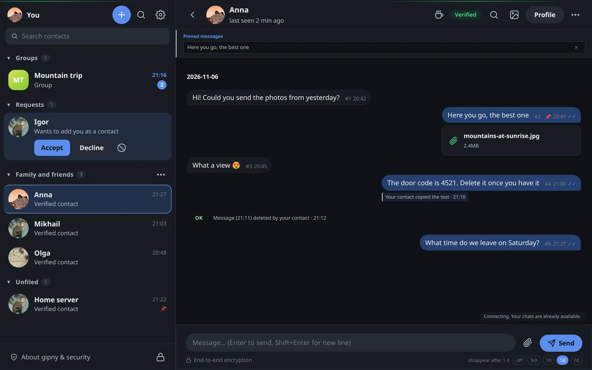
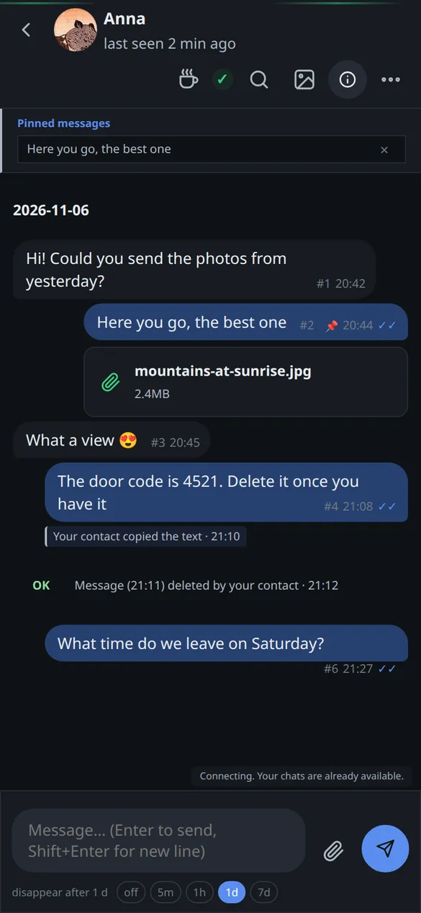

# gipny.i2p

[Русский — основной](README.md) · [Website](https://gluckdev.github.io/gipny-i2p/?lang=en) · [Web messenger](https://gluckdev.github.io/gipny-i2p/app/browser.html) · [Documentation](docs/README.md)

An open-source messenger with a local identity, end-to-end encryption and
I2P delivery, without registering a phone number or email. This is an I2P fork
of gipny; the [migration history](MIGRATION-i2p.md) is retained separately.

  
  

A demo profile: the names and messages are made up.

## Status

The source version is **0.5.0-rc3**. A source version, a passing build,
a published package and a deployed service are different things.
See [current capabilities](docs/current-state.md). The rc3 changes (durable
receive, WSS/WebRTC bridge, UPnP, browser files) require their own CI results. Backwards compatibility
with old experimental profiles is not currently required.

## Get started

1. Choose a package for your OS and architecture from
   [published releases](https://github.com/gluckdev/gipny-i2p/releases), when available.
   Verify its [SHA256 checksum](docs/update-verification.md). The Android client
   needs a system WebView of Chromium 83 or newer (Huawei WebView 11 on EMUI 11
   is the oldest supported).
2. Create a local password-protected profile. Native storage requires a supported
   OS credential provider. Allow time for the embedded I2P router to build tunnels.
3. Exchange [contact cards](docs/contact-cards.md) and compare fingerprints through
   a trusted channel. A syntactically valid card does not establish a person's identity.
4. Choose history storage and message timers. Deletion cannot erase copies,
   screenshots, exported files or notifications independently saved by a recipient.

The web client runs WASM in a Worker and stores an encrypted OPFS profile,
without a local server installation. The public GitHub Pages page currently
works offline only: no bridge is deployed and no network configuration is set,
so a profile and saved chats open while sending and receiving stay unavailable
until an operator deploys a bridge. It needs HTTPS and current Chrome or Firefox,
or Safari/iOS 16.4; Lockdown Mode and private browsing do not work.
See [PWA use and hosting](docs/browser-messenger.md).
Clearing site data can remove the profile. Browser profile export is not implemented
yet. GitHub serves code and updates; the local WASM core handles conversations,
and I2P delivers them through a separate transport bridge.

## Capabilities and boundaries

| Feature | Native | Browser |
|---|---|---|
| Direct chats, groups, cards and fingerprints | Implemented | Implemented; separate browser validation |
| End-to-end encryption | X3DH / Double Ratchet | Shared libcore cryptography |
| Storage | SQLCipher and OS binding | Two encrypted OPFS slots; password / WebAuthn PRF |
| Attachments | Inline and multipart | Multipart up to 2 GiB; separate OPFS, 16 MiB profile |
| Router | Embedded libi2pd | Client-only emissary WASM |
| I2P entry transport | NTCP2 / SSU2 | WSS or WebRTC to a Rust bridge, then NTCP2 |
| Agent, OS commands, DHT node | Native features | Unsupported |

WebRTC transport does not provide audio/video calls. DHT names, Android biometric
unlock and avatar synchronization are not advertised as complete merely because
some implementation pieces exist. See
[current state and roadmap](docs/current-state.md).

## Privacy

Content is encrypted before reaching a relay. Relays and transport intermediaries
observe some metadata. Delivery depends on I2P, relays and bootstrap availability;
relay acceptance is different from recipient delivery or reading.
Native NTCP2/SSU2 is not automatically wrapped in WebRTC/CDN traffic.
Browser WSS and WebRTC change the outer transport without proving traffic
indistinguishability. A compatible CDN can proxy WSS; WebRTC may need a separate
TURN service for NAT traversal or relay-only operation.

On phones the system keyboard is never shown: text is typed on the app's own
on-screen keyboard (RU/EN/DE/VI/KM layouts, digits, symbols, emoji), so keystrokes do
not reach third-party suggestion services; on Android the app window does not
interact with the system keyboard at all. A hardware keyboard keeps working;
nothing changes on a desktop. [Plan and limits](docs/plans/2026-11-08-own-keyboard.md).

A compromised device or hostile browser-origin code can expose unlocked data.
Read the [security policy](SECURITY.md), [memory boundary](docs/memory-security.md)
and [storage guide](docs/device-bound-storage.md). Pre-releases may include
[detailed diagnostics](docs/release-diagnostics.md).

## Development

Application builds and executable tests run in **GitHub Actions**. Local source
review, edits and documentation/data validation are allowed.
[Build and release guide](docs/build-release.md), [workflows](.github/workflows/README.md),
[upstreams and settings](docs/upstreams-and-settings.md).
Upstream changes must preserve reviewed patches and pass real delivery checks.
Hop counts, transit settings and timeouts need comparable measurements.

| Component | Guide |
|---|---|
| Tauri native client and Android | [core](core/README.md), [Android](core/gen/android/README.md) |
| Crypto, delivery and storage | [libcore](libcore/README.md) |
| UI and localization | [ui](ui/README.md), [RU/EN](docs/localization.md) |
| WASM and transport bridge | [browser-router](browser-router/README.md), [forwarder](browser-router/forwarder/README.md) |
| DHT and relay | [dht](dht/README.md), [relay](core/relay/README.md) |
| Remote command agent and bot API | [agent](agent/README.md), [bot-sdk](bot-sdk/README.md) |
| Native router library | [android-router](android-router/README.md), [JNI](docs/android-jni-build.md) |
| Website and integration tests | [site](site/README.md), [e2e](tests/e2e-harness/README.md) |

The agent executes commands with its OS account's privileges. Grant access only
to a verified master. An OpenWrt package does not guarantee secure credential
storage on every router; see [OpenWrt](docs/openwrt.md).

Russian is the primary documentation language, followed by English. Dated records
are historical evidence, not current setup instructions. The fork declares GPL-3.0;
upstream licenses and attribution remain intact.
