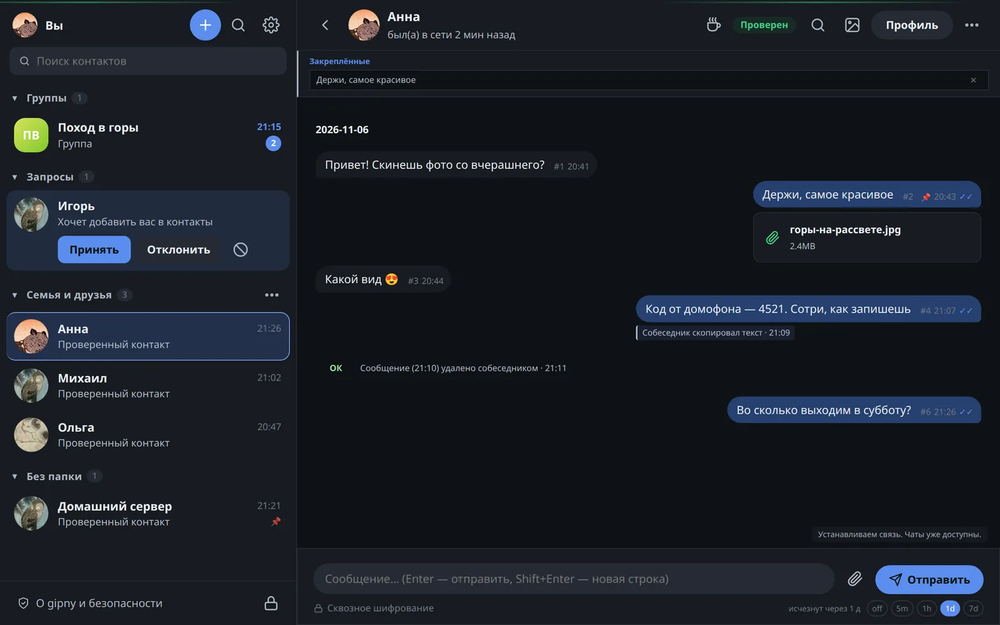
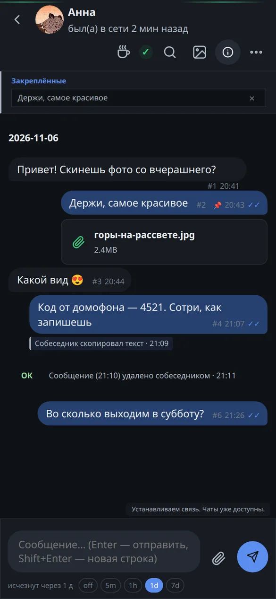

# gipny.i2p

[English](README.en.md) · [Сайт](https://gluckdev.github.io/gipny-i2p/) · [Веб-мессенджер](https://gluckdev.github.io/gipny-i2p/app/browser.html) · [Документация](docs/README.md)

Мессенджер с открытым исходным кодом: локальная личность, сквозное шифрование,
переписка через I2P без регистрации номера телефона или email.
Это I2P-форк gipny; [история перехода](MIGRATION-i2p.md) сохранена отдельно.

  
  

Демонстрационный профиль: имена и переписка вымышлены.

## Состояние

Исходники имеют версию **0.5.0-rc3**. Версия в файле, успешная сборка,
опубликованный пакет и работающий публичный сервис — разные состояния.
Состав реализации и ограничения перечислены в [текущем состоянии](docs/current-state.md).
Изменения rc3 (надёжный приём, мост WSS/WebRTC, UPnP, браузерные файлы) требуют собственного CI.
Данные старых экспериментальных версий сейчас не обязаны быть совместимы.

## Начать общение

1. Для компьютера или Android выберите подходящий пакет на
   [странице релизов](https://github.com/gluckdev/gipny-i2p/releases), когда он
   опубликован. Сверьте SHA256; [порядок проверки](docs/update-verification.md).
   Android-клиенту нужна системная WebView не старше Chromium 83 (Huawei
   WebView 11 на EMUI 11 — самая старая поддерживаемая).
2. Создайте локальный профиль с паролем. Нативному клиенту нужен поддерживаемый
   защищённый credential provider ОС. Дайте встроенному I2P построить туннели.
3. Обменяйтесь контактными карточками и сравните отпечатки по доверенному каналу.
   Карточка не доказывает личность человека: [формат карточек](docs/contact-cards.md).
4. Выберите политику истории и таймер сообщений. Отдельные копии, уведомления,
   экспорт и скриншоты собеседника не исчезают от команды удаления.

Веб-клиент запускает WASM-ядро в Worker, хранит зашифрованный профиль в OPFS
и не требует локального сервера. Нужны поддерживаемый браузер, HTTPS и доступный
транспортный мост. При отсутствии сетевой конфигурации доступно только локальное
хранилище. [Возможности, установка PWA и размещение](docs/browser-messenger.md).
Очистка данных сайта может удалить профиль. Экспорт браузерного профиля пока
не реализован. GitHub раздаёт код и обновления; переписку обрабатывает локальное
WASM-ядро, а доставку обеспечивает I2P через отдельный транспортный мост.

## Возможности и границы

| Возможность | Нативный клиент | Браузер |
|---|---|---|
| Личные чаты, группы, карточки, отпечатки | Реализованы | Реализованы; отдельная проверка браузера |
| Сквозное шифрование | X3DH / Double Ratchet | Общая криптография из libcore |
| Хранилище | SQLCipher и привязка к ОС | Два зашифрованных слота OPFS, пароль / WebAuthn PRF |
| Вложения | Inline и передача частями | Частями до 2 ГиБ; отдельный OPFS, профиль до 16 МиБ |
| Роутер | Встроенный libi2pd | Client-only emissary WASM |
| Вход в I2P | NTCP2 / SSU2 | WSS либо WebRTC до Rust-моста, затем NTCP2 |
| Агент, команды ОС, DHT-узел | Отдельные нативные возможности | Не поддерживаются |

WebRTC-транспорт не означает наличие аудио- или видеозвонков. Имена DHT,
биометрический вход Android и синхронизация аватаров не объявляются
завершёнными по наличию отдельных функций в коде.
[Статусы и планы](docs/current-state.md) отделены от готовых возможностей.

## Приватность

Содержимое шифруется до релея. Релей и транспортные посредники видят часть
сетевых метаданных; доставка зависит от доступности I2P, релеев и начальных узлов.
Принятие сообщения релеем не равно получению или прочтению собеседником.

Нативные NTCP2/SSU2 не маскируются автоматически под WebRTC/CDN. Браузерный WSS
и новый WebRTC меняют внешний транспорт, но не доказывают неотличимость от
обычного трафика. Обычный CDN может проксировать WSS при поддержке этой функции;
для WebRTC за NAT может требоваться отдельный TURN.

На телефонах системная клавиатура не показывается: текст набирается собственной
экранной клавиатурой приложения (раскладки RU/EN/DE/VI/KM, цифры, символы, эмодзи), и
набранное не уходит в сторонние сервисы подсказок. Физическая клавиатура работает
как прежде; на компьютере ничего не меняется.
[План и границы](docs/plans/2026-11-08-own-keyboard.md).

Нельзя обещать защиту от скомпрометированного устройства или вредоносного кода
хостинга браузерного клиента. Подробности: [безопасность](SECURITY.md),
[память](docs/memory-security.md), [хранилище](docs/device-bound-storage.md).
Пре-релизы могут содержать подробные журналы; [политика диагностики](docs/release-diagnostics.md).

## Разработка

Сборки и исполняемые тесты приложения выполняются в **GitHub Actions**.
Локально допустимы анализ исходников, правки и проверки документации/данных.
CI-команды, pins, происхождение пакетов и ограничения:
[сборка и релизы](docs/build-release.md), [workflows](.github/workflows/README.md).

Upstream обновляется с проверкой патчей и реальной доставки. Изменение числа
хопов, профиля транзита или таймаутов требует сравнимых измерений, а не обещания
«оптимальности». [Настройки и upstream](docs/upstreams-and-settings.md).

| Компонент | Руководство |
|---|---|
| Нативный клиент, Tauri и Android | [core](core/README.md), [Android](core/gen/android/README.md) |
| Криптография, доставка и хранение | [libcore](libcore/README.md) |
| Интерфейс и локализация | [ui](ui/README.md), [RU/EN](docs/localization.md) |
| WASM и транспортный мост | [browser-router](browser-router/README.md), [forwarder](browser-router/forwarder/README.md) |
| DHT и отдельный релей | [dht](dht/README.md), [relay](core/relay/README.md) |
| Удалённые команды и боты | [agent](agent/README.md), [bot-sdk](bot-sdk/README.md) |
| Нативная библиотека роутера | [android-router](android-router/README.md), [JNI](docs/android-jni-build.md) |
| Веб-сайт и проверки | [site](site/README.md), [e2e](tests/e2e-harness/README.md) |

Агент выполняет команды с правами своей учётной записи ОС. Предоставляйте доступ
только проверенному мастеру. Наличие OpenWrt-архива ещё не гарантирует доступность
защищённого хранилища на конкретном роутере: [OpenWrt](docs/openwrt.md).

Русский — основной язык документации; английская версия или раздел следует вторым.
Исторические протоколы проверок и планы помечаются датой и не служат инструкцией
запуска текущего дерева. Декларация лицензии форка: GPL-3.0; лицензии и авторство
upstream сохраняются, новая лицензия им этим текстом не назначается.
