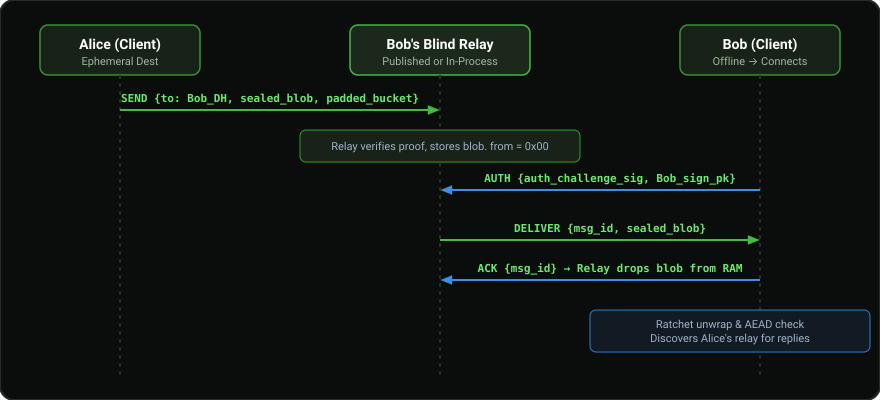

[English documentation](README.en.md) · [Локализация и её поддержка](docs/localization.md)

<div align="center">


<br/>

[](https://github.com/gluckdev/gipny-i2p/actions/workflows/build.yml?query=branch%3Amain)
[](https://github.com/gluckdev/gipny-i2p/actions/workflows/e2e-i2pd.yml)
[](https://github.com/gluckdev/gipny-i2p/actions/workflows/codeql.yml?query=branch%3Amain)
[](https://www.rust-lang.org/)
[](https://www.gnu.org/licenses/gpl-3.0.html)

<p align="center">
  <b>Анонимный десктопный и мобильный мессенджер со сквозным шифрованием поверх сети I2P.</b><br/>
  Без телефонных номеров, без email, без логинов и паролей на серверах.<br/>
  Идентификатор — только криптографическая пара ключей. Исходящая I2P destination клиента создаётся заново на каждую сессию; состояние роутера хранится отдельно.
</p>

[Ключевые особенности](#-ключевые-особенности) •
[Что умеет приложение](#-что-умеет-приложение) •
[Архитектура](#-архитектура-и-транспорт) •
[Протокол доставки](#-протокол-слепой-доставки) •
[Сборка и запуск](#-сборка-и-запуск) •
[Безопасность](#-модель-безопасности) •
[Оговорки](#-честные-технические-оговорки) •
[Агент и бот](#-агент-и-бот--в-чём-разница)

</div>

---

> ℹ️ **О форке gipny-i2p:**
> Это I2P-форк оригинального мессенджера gipny. Сетевой транспорт полностью переведён с Tor (Arti) на **I2P** (на базе C++ роутера `i2pd`, вкомпилированного в каждый бинарь как библиотека). Криптографическое ядро, схема Double Ratchet, зашифрованный вольт SQLCipher и интерфейс сохранены.
> Подробная история перехода зафиксирована в [MIGRATION-i2p.md](MIGRATION-i2p.md).

---

## Состояние ветки и первый запуск

Версия в manifests — **0.4.19**, кандидат следующего выпуска;
последний опубликованный релиз — **0.4.18**. Объединённая ветка
`feat/today-integration-20261028` содержит изменения **после этой версии**:
полную EN/RU локализацию, обязательный SHA256 updater, атомарный group outbox,
сайт для Pages, исправления Android JNI/APK staging, удаление DM у обоих
и новую политику диагностики. Защита секретов в RAM и новые release targets
также готовятся в этой ветке.
Это ещё не новый релиз. Бейджи Build/CodeQL выше показывают последний run
ветки `main`; они не отражают изменения открытого
[PR #121](https://github.com/gluckdev/gipny-i2p/pull/121).
У кандидата есть успешные компонентные прогоны, но общий CI и пробная упаковка
релиза пока не имеют полного PASS. Старый результат «5/5 delivered» подтверждал
конкретный e2e-сценарий и ревизию, а не всю сборочную матрицу.
[Состав, проверки и ограничения на 2026-10-28](docs/today-2026-10-28.md).

1. Возьмите сборку своей платформы со [страницы релизов](https://github.com/gluckdev/gipny-i2p/releases).
2. Создайте локальный профиль с паролем; регистрация на сервере не нужна.
3. Дождитесь встроенного роутера и туннелей. Холодный старт может занять минуты.
4. Передайте карточку или QR из «Моей карточки» по доверенному каналу.
5. Добавьте карточку собеседника, примите запрос и отдельно сверьте отпечатки ключей.

В кандидате новая карточка — `gipny:v3:<payload>`: без имени, с адресом релея
**187 ASCII-символов** вместо полного I2P Destination. Оба публичных ключа
сохраняются целиком; адреса представлены полными 256-битными b32 hashes.
Соединению нужен штатный I2P lookup/LeaseSet; checksum карточки обнаруживает
ошибки копирования и не заменяет сверку отпечатка. Старые v1/v2 читаются:
[формат и ограничения](docs/contact-cards.md).

Ни устанавливать i2pd отдельно, ни включать SAM service не требуется.
Для первого знакомства после перезапуска берите свежую карточку встроенного
релея; у установившихся контактов адрес обновляется протоколом.

## ⚡ Ключевые особенности

```
          ┌──────────────────────────────────────────────────────────┐
          │                   gipny-i2p Стек                         │
          ├──────────────────────────┬───────────────────────────────┤
          │ 🛡️ Криптография          │ X3DH + Double Ratchet         │
          │                          │ XChaCha20-Poly1305, Ed25519   │
          ├──────────────────────────┼───────────────────────────────┤
          │ 🧅 Сеть и Анонимность    │ i2pd внутри процесса          │
          │                          │ Эфемерные адреса, publish:false│
          ├──────────────────────────┼───────────────────────────────┤
          │ 💾 Защита на диске       │ SQLCipher (AES-256) + Argon2id│
          │                          │ Duress-пароль / Decoy профиль │
          ├──────────────────────────┼───────────────────────────────┤
          │ 📡 Релей и Метаданные    │ Sealed Sender (from = 0x00)   │
          │                          │ Фиксированные корзины паддинга│
          ├──────────────────────────┼───────────────────────────────┤
          │ 🕸️ Сеть релеев           │ Kademlia, записи шифрованы     │
          │                          │ и подписаны, ключи по суткам  │
          ├──────────────────────────┼───────────────────────────────┤
          │ 🤖 Автономный агент      │ Удалённая консоль в чате      │
          │                          │ Встроенный Bot SDK для ботов  │
          └──────────────────────────┴───────────────────────────────┘
```

- 🔒 **Шифрование до релея:** X3DH + Double Ratchet защищают содержимое; выдаваемый envelope использует `from = [0u8; 32]` (sealed sender). Это не обещание отсутствия метаданных у оператора: остаются аутентификация соединения, получатель, время и размерная корзина. Обычный payload ограничен примерно 4 МиБ; крупные файлы идут частями.
- 🌐 **Встроенный I2P-роутер (`i2pd`):** Не нужно настраивать сторонние демоны или прокси. `libi2pd` вкомпилирован в приложение, агент и релей (крейт `i2p-embed`) и работает в их же процессе. SAM, локальные proxy и web console отключены; сетевые транспорты самого роутера используют IP.
- 🎭 **Эфемерный сетевой след:** Исходящая destination генерируется заново при каждом запуске; её приватные ключи хранятся в памяти сессии. Постоянное состояние самого роутера хранится на диске отдельно. Исходящая сессия клиента не публикуется (`publish: false`); публикуется только адрес встроенного релея — он тоже новый при каждом запуске.
- ⚡ **У каждого свой релей:** адрес релея отправителя едет внутри зашифрованного конверта каждого сообщения, поэтому маршрут для ответов обновляется сам, без обмена новыми карточками.
- 🕸️ **Сеть релеев:** релеи клиентов образуют распределённую сеть. Если релей получателя молчит, письмо запечатывается и остаётся в сети до недели, пока адресат не включит приложение; оттуда же берутся его новый адрес и ключи для первого сообщения. Хранящий узел видит только шифротекст под ключом, который меняется каждые сутки.
- 🏠 **Встроенный релей в процессе:** приложение поднимает собственный релей при запуске — сторонний сервер не нужен, настраивать нечего.
- 💼 **Защита от физического давления (Duress & Anti-Forensics):**
  - Возможность задать альтернативный пароль под принуждением: запуск с фейковой базой (**Decoy**) либо удаление профиля/ключей по выбранной политике; сохранённые копии и SSD требуют отдельных оговорок.
  - Лимит попыток ввода: автоматический wipe профиля при брутфорсе.
  - В кандидате защищённые ключевые containers используют locked pages и короткие zeroizing exposures; process hardening зависит от ОС. Это не шифрование всей RAM: [границы памяти и WebView](docs/memory-security.md).
- 🤖 **Удалённый агент и боты без интерфейса:** выполнение команд из чата доверенного мастера и SDK на Rust для своих ботов (`bot-sdk`).

---

## 🧾 Что умеет приложение

Список возможностей дерева исходников. Помеченные «следующая версия» изменения
ещё не являются обещанием для скачанной 0.4.18. В скобках — история появления; заметки к каждой версии лежат в [`docs/releases/`](docs/releases/)
и на [странице релизов](https://github.com/gluckdev/gipny-i2p/releases).

**Переписка**

- Личные чаты и группы: создание группы, участники, отдельные счётчики
  непрочитанного (0.4.0).
- Групповые сообщения сохраняются в очереди до подтверждения каждого
  ожидаемого получателя и повторяются после обрыва или перезапуска до семи
  дней. «Доставлено» появляется после последнего ожидаемого подтверждения
  (unreleased). Сообщение, reply/settings, метаданные вложений, file offers и весь
  снимок получателей фиксируются одной транзакцией до сетевого `await`;
  [контракт и ограничения](docs/group-delivery.md).
- Вложения: файлы и картинки, галерея «медиа и файлы» по чату, вставка
  картинки из буфера обмена, сохранение на диск (0.4.0). Файлы больше 128 КБ
  идут частями по 192 КБ и собираются у получателя в любом порядке,
  с полосой прогресса и отменой, передача переживает обрыв и
  перезапуск; части идут сразу по нескольким потокам до релея получателя
  (следующая версия). Лимиты обработки в памяти и потокового чтения различаются:
  [Core](core/README.md), [libcore](libcore/README.md). Раньше вложение ехало
  одним письмом, и больше ~4 МБ не доходило.
- Ответы на сообщение, правки, удаление, пересылка в другой чат, закрепление
  сообщений и чатов (0.4.0).
- **Unreleased:** в личном диалоге любой участник удаляет своё сообщение или
  сообщение собеседника вместе с вложениями у обоих. Неизменяемые номера и
  отметки сохраняют пропуски в истории; запрос повторяется до E2E ACK.
  Очистка и явно заданный таймер используют тот же протокол, включая pinned DM.
  Старые клиенты и сообщения без исходного ID имеют явные ограничения:
  [message-deletion.md](docs/message-deletion.md). Копии вне приложения не отзываются.
- Поиск по всем сообщениям (FTS5 внутри зашифрованной базы) (0.4.0).
- Индикатор набора текста, отметки «отправлено» и «доставлено», уведомления со
  звуком, режим «без уведомлений» по чату (0.4.0).
- Кнопки под сообщениями (инлайн-клавиатуры) для ботов (0.4.0).

**Контакты**

- Карточка контакта: два открытых ключа и адрес релея, без телефона и почты
  (0.4.0).
- Запросы в контакты: добавили карточку — у человека появляется запрос
  «принять / отклонить / заблокировать»; до принятия ваши сообщения ему не
  показываются (0.4.3).
- Проверка по отпечатку ключей, метка «проверенный», блокировка, метка «бот»
  (0.4.0).
- Папки контактов: свои, сворачиваемые, с переносом контакта через его меню
  (0.4.4).
- Аватарки: персонаж японских гравюр XIX века каждому контакту, случайно и с
  возможностью сменить (0.4.4).
- Обмен карточками по QR: свой код в «моей карточке», сканирование камерой при
  добавлении контакта (0.4.6).
- Сброс сессии шифрования для контакта, если сообщения перестали доходить
  (0.4.0).

**Доставка**

- Встроенный релей у каждого клиента, новый адрес при каждом запуске, почта и
  prekey-пакет только владельца (0.4.2).
- Внешний выделенный релей как альтернатива — ящик, который принимает почту,
  пока приложение закрыто (0.4.0).
- Повторная отправка неподтверждённого письма до 7 дней (0.4.3).
- Сеть релеев: узлы находят друг друга и публикуют свои адреса для контактов
  (0.4.4); отправка и сбор писем через сеть, когда релей собеседника молчит, и
  подтверждаемое обновление адреса (0.4.5).
- Отправка сразу, не дожидаясь своего релея (0.4.6).
- Первые письма тому, кого нет в сети, доходят вслед за знакомством; письма не
  обгоняют друг друга; недоступный узел сети не тормозит каждое письмо;
  запомненные узлы сети не стираются запуском без связи (0.4.11).
- Агент и боты доставляют через сеть релеев, как приложение; групповые
  рассылки ботов теперь стоят в очереди до E2E ACK каждого ожидаемого получателя (unreleased).
- Встроенный релей держится при любом числе коротких соединений сети релеев
  (0.4.11).

**Приватность и защита**

- Сквозное шифрование X3DH + Double Ratchet, XChaCha20-Poly1305 (0.4.0).
- Sealed sender: `from = [0; 32]` в выдаваемом envelope; это не скрывает всю информацию об аутентифицированном соединении от оператора релея.
- Паддинг до фиксированных корзин; предел обычного payload — около 4 МиБ, крупные вложения передаются частями.
- Очистка метаданных у вложений (EXIF в картинках, служебные поля PDF) —
  *Настройки → Приватность* (0.4.2).
- Зашифрованный профиль: SQLCipher (AES-256) и Argon2id, несколько профилей на
  устройстве (0.4.0).
- **Следующая версия:** OS device binding защищает ключи профиля и headless
  SQLCipher; недоступный credential provider означает явный отказ.
  [Платформенные ограничения](docs/device-bound-storage.md).
- **Следующая версия:** guarded encrypted containers защищают простаивающие
  секреты; WebView держит историю только активного чата и очищает известные
  копии при switch/lock/delete. Это не гарантия всей RAM или GC-стирания:
  [границы памяти](docs/memory-security.md).
- Пароль под принуждением: пустой профиль-обманка или экстренное затирание;
  лимит неверных попыток с автоматическим затиранием (0.4.0).
- Резервная копия: экспорт в зашифрованный файл и импорт в новый профиль
  (0.4.0).
- Страница «О gipny и безопасности» — что именно и как защищено, с честными
  ограничениями (0.4.4).

**Сеть и обновления**

- Встроенный роутер i2pd в каждой сборке, на Android — внутри приложения
  (0.4.0).
- Настройки роутера: доля транзитного трафика, Yggdrasil (выключен /
  автоматически / всегда) (0.4.0).
- Обновления идут через I2P outproxy с TLS. В этой ветке SHA256 обязателен для
  каждого asset, включая APK picker и агент; отсутствие или повреждение manifest
  останавливает загрузку. Прежний destination заменяется только после проверки.
  Это целостность относительно Release, а не независимая подпись publisher:
  [update-verification.md](docs/update-verification.md).
- Android JNI и установка APK исправлены в объединённой ветке: проверенная
  копия в private cache/updates, ограниченный FileProvider и системный installer.
  Разрешение пользователя и проверки на устройстве остаются необходимы.
- Состояние сети релеев в настройках: сколько узлов известно, сколько хранится
  для других, роль устройства (0.4.4).
- Новая политика диагностики: подробные DEBUG-логи только для тестов и
  диагностических сборок; release выводит предупреждения/ошибки и не пишет
  файловый debug.log. Это заменяет старое обещание включённого по умолчанию
  журнала: [release-diagnostics.md](docs/release-diagnostics.md).
- Восстановление туннелей не означает перезапуск C++ после его падения: встроенный роутер разделяет crash boundary с приложением.
- Обновления нельзя подменить чужим корневым сертификатом (0.4.7).
- Туннели строятся, пока вы набираете пароль (0.4.10).
- Старые SAM session IDs не являются текущей защитой: SAM удалён, взаимодействие с роутером идёт через FFI внутри процесса.
- Роутер внутри процесса: SAM, HTTP-прокси и web console отключены;
  обновления идут своим потоком i2p к outproxy; сертификаты reseed вшиты и
  проверяются (следующая версия).
- `gipny-relay --dht`: выделенный релей как постоянный узел сети релеев
  (0.4.11).

**Интерфейс**

- Оформление как у привычного мессенджера: аватарки, имя и статус в списке,
  «пузыри» со временем и галочками (0.4.4).
- Светлая и тёмная темы и «как в системе» (0.4.0).
- Раскладка для телефона и планшета, сворачиваемая панель чатов (0.4.1).
- Английский и русский интерфейс; выбор до входа и в настройках, без перезапуска
  (полный перевод включён в эту ветку, ещё не в выпуск 0.4.18).
- Видимый запуск профиля: этапы, время каждого, технические подробности,
  «открыть чаты сейчас» (0.4.6).
- «Кофеин»: экран не гаснет, чат не переключается, выход по паролю (0.4.6).
- Android: «назад» убирает приложение с экрана, а не завершает его; падения
  при сворачивании и на проверке обновлений устранены (0.4.7, 0.4.8).
- Строка состояния канала над чатом — измеренная, а не угаданная; «кокаин»
  внутри «кофеина»: путь на один узел короче, с честно названной ценой (0.4.9).
- «В сети» — только по живому сигналу; релей говорит, что с ним не так (0.4.10).

**Автоматизация**

- Режим агента: доверенный контакт («мастер») выполняет команды на вашей машине
  прямо из чата (0.4.0).
- `gipny-agent` — то же самое без интерфейса, для сервера (0.4.0), со своим
  встроенным релеем (0.4.2) и автообновлением (0.4.2).
- `bot-sdk` — крейт для своих ботов (0.4.0).

### Английский и русский интерфейс

Полный перевод новой ветки охватывает создание профиля, чаты, контакты, группы,
QR, безопасность, backup, обновления, уведомления и консоль агента. Язык можно
выбрать до разблокировки и в **Настройки → Язык**. Выбор хранится на устройстве;
без него локали браузера `ru`, `be`, `uk` дают русский, остальные — английский.

Переключение не перезапускает и не блокирует профиль. Черновики, ссылки на
вложения, ответы и текущая правка сохраняются в памяти. Имена, сообщения,
файлы, команды, вывод и загруженные заметки к релизу остаются в исходном виде.
Для известных native errors есть английские пояснения, неизвестная диагностика
сохраняется. Системные диалоги используют язык ОС.
[Как поддерживать обе локали](docs/localization.md), [устройство UI](ui/README.md).

### Версии

| Версия | Про что она | Заметки |
|---|---|---|
| 0.4.19 (кандидат) | Объединённая ветка, ещё не опубликованный релиз | [Состав и статус](docs/today-2026-10-28.md) |
| [0.4.18](https://github.com/gluckdev/gipny-i2p/releases/tag/v0.4.18) | Последний опубликованный релиз; новые изменения в него не входят | [0.4.18.md](docs/releases/0.4.18.md) |
| [0.4.17](https://github.com/gluckdev/gipny-i2p/releases/tag/v0.4.17) | Без изменений в приложении: сборка сверяет ревизию роутера и не запускается на правках документации | [0.4.17.md](docs/releases/0.4.17.md) |
| [0.4.16](https://github.com/gluckdev/gipny-i2p/releases/tag/v0.4.16) | QR с камеры и из файла; сообщения исчезают через сутки; очистка истории при блокировке; собеседник видит, что не удаляет у себя | [0.4.16.md](docs/releases/0.4.16.md) |
| [0.4.13](https://github.com/gluckdev/gipny-i2p/releases/tag/v0.4.13) | Письмо в сети, только когда его взял другой узел; единственный узел не выпадает после неудачи; свой релей не зависает | [0.4.13.md](docs/releases/0.4.13.md) |
| [0.4.12](https://github.com/gluckdev/gipny-i2p/releases/tag/v0.4.12) | Своя почта читается напрямую, без i2p; телефон не теряет сеть после смены Wi-Fi/LTE; первое письмо после запуска уходит быстрее | [0.4.12.md](docs/releases/0.4.12.md) |
| [0.4.11](https://github.com/gluckdev/gipny-i2p/releases/tag/v0.4.11) | Встроенный релей больше не глохнет; первые письма тем, кого нет в сети, доходят; агент и боты пишут через сеть релеев | [0.4.11.md](docs/releases/0.4.11.md) |
| [0.4.10](https://github.com/gluckdev/gipny-i2p/releases/tag/v0.4.10) | Туннели строятся, пока набирается пароль; «в сети» больше не выдумывается; обновления доходят до Android | [0.4.10.md](docs/releases/0.4.10.md) |
| [0.4.9](https://github.com/gluckdev/gipny-i2p/releases/tag/v0.4.9) | Измеренное состояние канала над чатом; «кокаин» внутри «кофеина» — короче путь и без выравнивания размера | [0.4.9.md](docs/releases/0.4.9.md) |
| [0.4.8](https://github.com/gluckdev/gipny-i2p/releases/tag/v0.4.8) | «Назад» на Android прячет приложение, а не роняет его вместе с роутером | [0.4.8.md](docs/releases/0.4.8.md) |
| [0.4.7](https://github.com/gluckdev/gipny-i2p/releases/tag/v0.4.7) | Android больше не падает на проверке обновлений; обновление нельзя подменить чужим корневым сертификатом | [0.4.7.md](docs/releases/0.4.7.md) |
| [0.4.6](https://github.com/gluckdev/gipny-i2p/releases/tag/v0.4.6) | Видимый запуск профиля, отправка без ожидания своего релея, перезапуск умершего роутера, QR карточки, журнал работы, «кофеин» | [0.4.6.md](docs/releases/0.4.6.md) |
| [0.4.5](https://github.com/gluckdev/gipny-i2p/releases/tag/v0.4.5) | Доставка через сеть релеев, контакт не теряется при смене адреса, обязательные обновления | [0.4.5.md](docs/releases/0.4.5.md) |
| [0.4.4](https://github.com/gluckdev/gipny-i2p/releases/tag/v0.4.4) | Новый вид, папки контактов, аватарки, страница «О gipny», узлы сети релеев находят друг друга | [0.4.4.md](docs/releases/0.4.4.md) |
| [0.4.3](https://github.com/gluckdev/gipny-i2p/releases/tag/v0.4.3) | Запросы в контакты, повторы до 7 дней, привязка входа на релей к самому релею | [0.4.3.md](docs/releases/0.4.3.md) |
| [0.4.2](https://github.com/gluckdev/gipny-i2p/releases/tag/v0.4.2) | Встроенный релей по умолчанию, у агента тоже; очистка метаданных вложений | [0.4.2.md](docs/releases/0.4.2.md) |
| [0.4.1](https://github.com/gluckdev/gipny-i2p/releases/tag/v0.4.1) | Починка запуска роутера на десктопе, раскладка для телефона | [0.4.1.md](docs/releases/0.4.1.md) |
| [0.4.0](https://github.com/gluckdev/gipny-i2p/releases/tag/v0.4.0) | Первая версия на i2pd, релей в карточке контакта, режим агента, macOS и ARM | [0.4.0.md](docs/releases/0.4.0.md) |

---

## 🏛️ Архитектура и транспорт

Прикладные сообщения и обновления используют I2P. Сам роутер работает поверх IP
(NTCP2/SSU2, discovery/reseed); это не запрет всех IP-соединений процесса:

<div align="center">
  
</div>

### Как взаимодействуют компоненты:
1. **Ядро (Rust Core + Tauri):** Управляет сессиями, ключами X3DH, хранилищем сообщений в SQLCipher и шифрованием.
2. **Роутер внутри процесса (`i2p-embed`):** `libi2pd` вкомпилирован в каждый бинарь; C++ shim с C ABI над `libi2pd/api.h` (`i2p-embed/shim`) и обёртка на Rust (`Router`, `Destination`, `I2pStream`). Один роутер на процесс (`libcore/src/embedded.rs`, данные в `<data_dir>/i2p/router`). SAM, HTTP-прокси, SOCKS и web console отключены: локального bridge для посторонней программы нет ([история решения](docs/plans/2026-09-24-embedded-i2pd.md), #101, #102). Автообновление идёт своим потоком i2p к outproxy, TLS внутри (`libcore/src/i2p_http.rs`).
3. **Чесночные туннели:** `i2pd` строит исходящие туннели через распределенную сеть узлов I2P.
4. **Android:** `libi2pd` и та же прослойка собираются в `libi2pd.so` (`android-router/jni`), Rust-часть приложения линкуется с ней и запускает роутер тем же путём, что десктоп. `GipnyService.kt` только держит foreground-сервис и сообщает роутеру о смене сети.

---

## 📨 Протокол «слепой» доставки

Схема ниже показывает обмен через релей получателя. Текущая доставка также
использует сеть релеев для поиска адреса и временного хранения; её условия
описаны после схемы.

<div align="center">
  
</div>

### Этапы передачи:
1. **Депозит:** Алиса упаковывает сообщение по схеме Double Ratchet, дополняет паддингом до стандартизированной корзины и передаёт на релей Боба с адресацией по signing public key получателя. В выдаваемом envelope поле `from` обнулено; метаданные аутентифицированного соединения этим не скрываются.
2. **Офлайн-буфер:** Релей хранит зашифрованный блоб в памяти (или временном хранилище).
3. **Авторизация получателя:** Боб подключается к своему релею, подтверждает владение ключом через криптографический `AUTH challenge`.
4. **Выдача и ACK:** Релей пушит накопившиеся блобы Бобу. Transport ACK позволяет убрать запись из очереди релея. Отдельный E2E ACK внутри шифрованного payload подтверждает сохранение сообщения у получателя; это разные этапы, не доказательство физического стирания копий у оператора.

**Откуда Алиса знает релей Боба.** Из его карточки контакта (в кандидате `gipny:v3:<payload>`, legacy v1/v2 по-прежнему читаются), а дальше — из самих сообщений: каждое сообщение (кроме индикаторов набора) несёт внутри шифрованного конверта адрес релея отправителя, и клиент обновляет его у контакта, если он изменился. Поменяли релей в настройках — контакты узнают об этом с первым же вашим сообщением, новую карточку рассылать не нужно. Обновление аутентифицируется сессией Double Ratchet контакта; доверие к самой identity требует сверки отпечатка.

**Встроенный релей (по умолчанию).** Настраивать ничего не нужно: каждое приложение при запуске поднимает релей внутри себя и получает почту через него — напрямую, внутри процесса, а не через i2p (собеседники, конечно, приходят к нему через i2p). Destination встроенного релея создаётся заново при каждом запуске. Это снижает постоянство адреса, но не исключает корреляцию трафика или сохранение адреса контактами. Релей личный: он хранит письма и prekey-пакет только своего владельца и отказывает всем остальным. После запуска релею нужно 1–2 минуты на постройку туннелей; затем приложение само сообщает новый адрес всем, с кем уже есть переписка.

**Когда релей получателя молчит — письмо идёт через сеть релеев.** Встроенный релей живёт вместе с приложением, поэтому адресата может не быть на месте. В этом случае клиент запечатывает письмо и оставляет его в сети релеев (`dht/`, `libcore/src/dht_client.rs`): узлы хранят шифротекст до семи дней под ключами почтового протокола; вступительные письма и карточки имеют отдельную модель доступа. Адресат забирает письмо при следующем запуске, подтверждает получение и удаляет его из сети. Оттуда же берутся его текущий адрес (если он перезапускался) и prekey-пакет для самого первого сообщения. Живой тест `e2e-dht` проверяет это целиком: B уходит, A пишет и уходит, B возвращается на новом адресе, читает и отвечает, уходит, A возвращается на новом адресе, читает ответы и узнаёт новый адрес B.

**Как приложение находит сеть релеев.** Через релеи контактов, запомненные с прошлых запусков узлы и вшитые в сборку сиды (`GIPNY_DHT_SEEDS`, переменная репозитория; только при сборке). Workflow `relay-testnet.yml` умеет держать тестовый `gipny-relay --dht` на воркере GitHub Actions; состояние переносится между запусками только зашифрованным `age`. Наличие workflow не означает, что сид доступен постоянно или его адрес включён в конкретный бинарь. Без доступного начального узла две перезапустившиеся установки могут не найти друг друга. Поиск адреса через NetDb самой I2P пока исследуется ([разбор](docs/plans/2026-09-24-netdb-rendezvous-evaluation.md)).

**Обновление маршрута для существующего контакта.** Адрес релея меняется при каждом запуске, но приложение повторяет объявление нового адреса — через релей собеседника или через сеть — пока от него что-нибудь не придёт: только это доказывает, что адрес дошёл. Переписка и ключи при этом не меняются.

Нужен ящик, который принимает почту, пока вас нет совсем, — переключите *Настройки → Релей* на **«внешний»** и укажите адрес выделенного релея (см. «Запуск собственного выделенного релея»). У `gipny-agent` то же самое: личный встроенный релей по умолчанию, `--relay` — внешний.

---

## 🗺️ Карта проекта: куда вносить правки

В каждом каталоге лежит свой `README.md`: что там за файлы, какая задача каким файлом решается, что надо менять вместе и как проверить. Начинайте с него, а не с поиска по всему проекту.

| Каталог | Что это | Путеводитель |
|---|---|---|
| `libcore/` | Общее ядро: криптография, сессии Double Ratchet, база, протокол релея, встроенный релей, запуск роутера внутри процесса, автообновление | [libcore/README.md](libcore/README.md) |
| `core/` | Приложение на Tauri (десктоп и Android): `Core`, команды для интерфейса, запуск профиля | [core/README.md](core/README.md) |
| `core/gen/android/` | Android-обёртка: сервис, манифест, ресурсы | [core/gen/android/README.md](core/gen/android/README.md) |
| `i2p-embed/` | Роутер i2pd внутри процесса: C-прослойка над `libi2pd/api.h`, обёртка на Rust, сборка libi2pd (`build.rs`) | — |
| `android-router/` | `libi2pd.so` для Android: libi2pd + прослойка + одна точка входа JNI | [android-router/README.md](android-router/README.md) |
| `core/relay/` | Выделенный релей `gipny-relay` (отдельный workspace) | [core/relay/README.md](core/relay/README.md) |
| `dht/` | Сеть релеев: ключи, запечатывание, протокол узлов, хранилище | [dht/README.md](dht/README.md) |
| `ui/` | Интерфейс (TypeScript без фреймворка), dev-превью с моками | [ui/README.md](ui/README.md) |
| `agent/` | `gipny-agent` — headless-агент с удалённой консолью | [agent/README.md](agent/README.md) |
| `bot-sdk/` | Bot SDK | [bot-sdk/README.md](bot-sdk/README.md) |
| `tests/e2e-harness/` | Сквозные тесты по живой сети i2p | [tests/e2e-harness/README.md](tests/e2e-harness/README.md) |
| `.github/workflows/` | CI, релизы, e2e, тестовый релей, скрипты заметок к релизу | [.github/workflows/README.md](.github/workflows/README.md) |
| `tools/` | Иконки, конвертеры конфигов sing-box | [tools/README.md](tools/README.md) |
| `site/` | Статический сайт проекта EN/RU для GitHub Pages | [site/README.md](site/README.md) |
| `docs/` | Документы: решения, планы, заметки к релизам, передача дел | [docs/README.md](docs/README.md) |
| `third_party/` | Сабмодули `i2pd` и `i2pd-android` — не править руками, пин двигает CI | — |

Правило: поменяли структуру каталога, добавили файл или перенесли ответственность — поправьте его `README.md` в том же коммите.

---

## 📦 Сборка и запуск

Команды сверяются с [CI workflows](.github/workflows/README.md). Сборка исходников,
APK с заглушкой и live I2P проверяют разные свойства. На этой объединённой ветке
итоговый CI ещё не завершён. По требованию владельца новые сборки и проверки
этой работы выполняются в **GitHub Actions** из исходников; происхождение
зависимостей и manifests описаны в [build-release.md](docs/build-release.md).
Команды ниже — справочник окружения и шагов CI, а не отчёт о новом локальном прогоне.

### Системные требования:
- **Rust:** `stable` (рекомендуется `rustup update`)
- **Node.js:** рекомендуется 24+ для UI и сайта; UI workflow использует актуальную Node 20, совместимую с Vite 8; `npm`.
- **C++ компилятор, Boost (program_options), OpenSSL, zlib** — `libi2pd` компилируется прямо в бинарь (`i2p-embed/build.rs`, переменные `I2P_EMBED_*`)

### 1. Локальная сборка под Linux:

```bash
# Клонирование с сабмодулями (i2pd)
git clone --recursive https://github.com/gluckdev/gipny-i2p.git
cd gipny-i2p

# Установка системных зависимостей (Debian/Ubuntu)
sudo apt install -y build-essential pkg-config curl git \
    libssl-dev zlib1g-dev libboost-program-options-dev \
    libgtk-3-dev libwebkit2gtk-4.1-dev \
    libayatana-appindicator3-dev librsvg2-dev libsoup-3.0-dev \
    libasound2-dev libgstreamer1.0-dev libgstreamer-plugins-base1.0-dev

# Как в CI: проверить pin и получить свежие сертификаты reseed.
.github/scripts/assert-i2pd-pin.sh
scripts/fresh-i2p-certs.sh /tmp/gipny-i2p-certs
export I2P_EMBED_CERTS_DIR=/tmp/gipny-i2p-certs

# Глоб ресурсов в tauri.conf.json (resources/i2pd*) должен что-то найти.
# В релизе там снимок netDb (i2pd-netdb-seed.tar.gz); для dev хватит заглушки.
mkdir -p core/resources && touch core/resources/i2pd-placeholder

# Сборка фронтенда
(cd ui && npm ci && npm run build && npm test)

# Запуск в dev-режиме: роутер вкомпилирован, отдельный i2pd не нужен
env -u CC -u CXX cargo run --locked -p gipny --bin gipny
```

Сначала установите Rust и совместимые Node/npm: пакеты дистрибутива могут быть
старше требуемых. Игнорируемая заглушка ресурсов нужна только для dev glob,
она не является бинарём роутера или рабочим снимком netDb. `env -u CC -u CXX`
убирает случайно экспортированный компилятор Android NDK.

### Проверки и платформы

```bash
env -u CC -u CXX cargo test --locked -p gipny-libcore
env -u CC -u CXX cargo test --locked -p gipny --lib
env -u CC -u CXX cargo test --locked -p gipny-dht
env -u CC -u CXX cargo test --locked --manifest-path core/relay/Cargo.toml
```

Это команды с настоящей native library. Для ограниченных Rust/SQLite unit
fixtures используют `I2P_EMBED_STUB=1`; такой бинарь не подключается к I2P.
`I2P_EMBED_SKIP_NATIVE=1` предназначен для `cargo check`, не линковки тестов.
Android job `build.yml` использует stub для упаковки; настоящий `libi2pd.so`
собирают release/i2p-embed workflows. JNI cross-check не равен установке на устройстве.
Windows/MSVC и macOS описаны в [workflow guide](.github/workflows/README.md),
Android — в [android-router/README.md](android-router/README.md).

Для OpenWrt в этой ветке готовятся отдельные статические musl-сборки headless
агента для AArch64, ARMv7 soft-float, x86_64 и i686/SSE2. Архитектуру CPU,
набор инструкций, память и доступное место нужно сверять с конкретным устройством;
это не обещание поддержки всех роутеров. MIPS/ARMv6 не заявлены:
[матрица и установка](docs/openwrt.md).
Новый runtime требует защищённый OS credential provider; headless/OpenWrt
без него отказывает в запуске. Наличие target не является обходом device binding.

### 2. Запуск собственного выделенного релея:

Ни приложению, ни `gipny-agent` он не обязателен — у каждого есть личный встроенный. Выделенный релей нужен, когда почта должна приниматься, пока приложение (или агент) закрыто: люди в разных часовых поясах, телефон, который усыпляет приложение.

```bash
# Сборка релей-сервера (отдельный workspace)
env -u CC -u CXX cargo build --locked --release --manifest-path core/relay/Cargo.toml

# Запуск: роутер внутри процесса, его данные в $GIPNY_RELAY_DATA/router,
# ключи адреса — в dest.key; отдельный i2pd не нужен; SIGTERM/Ctrl-C — чистая остановка
GIPNY_RELAY_DATA="$PWD/relay-data" ./core/relay/target/release/gipny-relay

# То же, и узел сети релеев: хранит запечатанные письма для других,
# переживает перезапуск; --seeds / GIPNY_DHT_SEEDS — через кого войти в сеть
GIPNY_RELAY_DATA="$PWD/relay-data" ./core/relay/target/release/gipny-relay --dht
```
*При первом запуске релей выведет свой публичный I2P Destination (Base64), который можно вставить в настройках мессенджера.*

---

## ⚡ Профиль замера (`GIPNY_FAST`)

Обычный запуск ничего не меняет: 2–3 хопа, туннели-разведчики, транзит по линии. Этот профиль выключен по умолчанию и включается переменной окружения — он существует, чтобы замерять связь между двумя узлами, и больше ни для чего.

```bash
# Оба узла: минимум хопов + никакого фонового трафика
GIPNY_FAST=1 GIPNY_FAST_HOPS=0 ./gipny-relay
GIPNY_FAST=1 GIPNY_FAST_HOPS=0 ./gipny
```

**`GIPNY_FAST_HOPS=0..3`** — длина туннелей вместо обычных 2–3. `0` — это не туннель, а прямое соединение двух роутеров друг с другом (`i2pd` такие строит штатно). На пустой сети `0` может не подняться: нужен прямой доступ к `RouterInfo` собеседника, который часто закрыт NAT. Начинать с `1`.

**`GIPNY_FAST=1`** — вместе с хопами выключается фон: туннели-разведчики (`exploratory.*.quantity=0`), транзит для чужих (`--share=0 --limits.transittunnels=0 --notransit`) и перепубликация `RouterInfo` по 39-минутному таймеру (`--trust.hidden=true`). Опции подменяют, а не дополняют настройки приложения — иначе i2pd умирает на повторном параметре в командной строке.

Что осталось и не отключается — `keepalive` транспортов и перепубликация `LeaseSet`: без последней собеседник просто не найдёт адрес.

> **Цена.** При нуле хопов роутеры видят IP друг друга напрямую. Более короткие туннели и отключённый padding меняют свойства приватности; один хоп не даёт гарантии анонимности. Этот профиль предназначен для замеров, а не обычной переписки.

---

## 📊 Сравнение и бенчмарки

Результаты сквозного тестирования в живой сети I2P, версия 0.4.11 ([e2e-i2pd run 35955326759](https://github.com/gluckdev/gipny-i2p/actions/runs/35955326759); все боты на одном общем роутере CI, уже прогретом):

| Параметр | Значение | Примечание |
| :--- | :--- | :--- |
| **Сценарии** | **5 из 5** | два бота через выделенные релеи; через встроенные релеи; бинарь агента; сеть релеев, стороны уходят по очереди |
| **Адрес клиента готов** | **12–27 с** | после запуска роутера (замер 0.4.11, тогда ещё SAM-сессия) |
| **Встроенный релей поднят** | **36–39 с** | туннели + публикация адреса |
| **Письмо туда и обратно** | **~42 с (медиана)** | через два встроенных релея, на 0.4.11; после него свой релей читается внутри процесса — минус один проход через i2p |
| **Оба по очереди офлайн** | **952 с сценарий целиком** | 3 письма и 3 ответа через сеть релеев, смена адресов, адрес находится |
| **Прикладной транспорт** | **I2P** | роутер сам использует IP; это не доказательство отсутствия сетевых утечек |
| **Холодный старт** | **1–3 мин** | первый запуск: reseed и построение туннелей |

Эти цифры предшествуют текущему in-process transport и не являются целями
задержки или доступности новой ветки. Текущие сценарии — в
[e2e workflow](.github/workflows/e2e-i2pd.yml) и [харнессе](tests/e2e-harness/README.md).

---

## 🛡️ Модель безопасности

| Граница | Реализация | Ограничение |
|---|---|---|
| Содержимое | X3DH, Double Ratchet, XChaCha20-Poly1305 до релея | Собственная интеграция; полного независимого аудита нет |
| Профиль приложения | SQLCipher, Argon2id, отдельный decoy, backup; в кандидате ключ связан с OS credential provider | Разблокированное устройство/RAM доступны при компрометации endpoint; Linux Secret Service не защищает от полного клона ОС |
| Headless | В кандидате агент/бот используют SQLCipher и защищённый OS provider | Без provider запуск отказывает; права каталога и raw key file его не заменяют |
| Память/WebView | Guarded encrypted key containers, active-chat-only UI cache и cleanup в кандидате | Открытый текст нужен IPC/DOM; немедленное стирание JS strings/GC и всей RAM не гарантируется. [Границы](docs/memory-security.md) |
| Релей/DHT | Ciphertext, sealed `from`, TTL и квоты | Аутентификация соединений, время, размеры, drop/eviction и Sybil остаются |
| Сеть | I2P; нет локального bridge/proxy | Роутер использует IP и делит процесс с приложением; crash завершает процесс |
| Обновления | TLS/webpki и обязательный SHA256 в новой ветке | Один Release для файла и hash не заменяет независимую подпись |

[Контракт OS binding и миграционные ограничения](docs/device-bound-storage.md):
Android требует TEE/StrongBox provider, Windows связывает key с user и machine,
macOS использует локальный системный Keychain вне профиля, Linux — Secret Service.
Бесплатная ad-hoc сборка macOS не требует подписки Apple; Keychain может запросить
согласие пользователя, в том числе после обновления. Полный перенос Keychain/ОС
не входит в гарантию этих software providers. Старые unbound profiles не
переписываются и не удаляются автоматически; нужен осознанный export/import.

## ⚠️ Честные технические оговорки

1. Холодный netDb и туннели могут занять минуты. Исторические замеры не являются SLA новой ветки.
2. Не запускайте копии одного профиля одновременно на разных устройствах: это копирует identity/ratchet. Multi-device протокол не реализован.
3. Offline mail зависит от узлов, TTL, квот и хранения. DHT acceptance не гарантирует будущую доставку. Seeds определяются при сборке; workflow testnet не обещает постоянного SLA.
4. Большие файлы идут через релей получателя, не почтовую DHT. ACK письма с offer не означает завершения файла. Android не хранит чужую DHT почту.
5. Корреляция времени/объёма, компрометация endpoint и publisher остаются рисками. Wipe и исчезающие сообщения не отзывают чужие копии.
6. Android Doze, Wi-Fi/LTE, installer и разные прошивки требуют проверок на устройствах. Host/stub tests этого не доказывают.
7. Обновления идут к GitHub через I2P outproxy (`exit.stormycloud.i2p`), без прямого fallback. Его доступность и shared rate limits влияют на работу. `.deb` требует действия пользователя, Android — разрешения источника и системного installer.

## Backup и перенос на другое устройство

В **Настройки → Backup** экспортируйте профиль с отдельной парольной фразой
не короче восьми символов. Импорт выполняется на экране выбора профиля нового
устройства. После переноса закройте старую копию: одна identity пока рассчитана
на одно активное устройство, параллельные копии могут разойтись по ratchet.
Утерянную парольную фразу backup восстановить нельзя.

## Сайт и браузерный клиент

[site/](site/README.md) — новый статический сайт проекта EN/RU с загрузками
нативного приложения. [pages.yml](.github/workflows/pages.yml) проверяет PR,
а deployment разрешён только с `main`; Settings → Pages требует отдельного
включения владельцем. Публикация ещё не выполнена. Сам сайт не создаёт профили
и не принимает сообщения, контакты или ключи. Посещение Pages остаётся обычным
web-запросом к хостингу.

Существующий `gipny-web` — серверный HTTP/WebSocket gateway: криптография,
vault и состояние работают на сервере. Это **не** целевой статический клиент.
Web-клиент с crypto/storage/I2P на устройстве, browser transport и временные
доли offline mail между независимыми хранилищами ещё исследуются. Pages раздаёт
статику; landing page не реализует этот мессенджер.

## 🤝 Агент и бот — в чём разница

Оба — обычные аккаунты gipny без человека за клавиатурой, с тем же сквозным
шифрованием. Разница в том, **кому они подчиняются и что делают**.

| | **Агент** (`gipny-agent`, режим агента) | **Бот** (`bot-sdk`) |
|---|---|---|
| Зачем | управлять машиной из чата: посмотреть логи, перезапустить сервис, забрать файл | отвечать людям: уведомления, справки, интеграции, кнопки |
| С кем говорит | **только с одним мастером**, чью карточку ему дали; всем остальным не отвечает | **с кем угодно**, запросов в контакты у ботов нет — он принимает всех |
| Что выполняет | команды оболочки на своей машине, строго по одной, с таймаутом и рабочим каталогом | только ваш код: обработчики `on_message`, `on_command`, `on_callback` |
| Кто пишет логику | никто: агент уже готов, логика — это ваши команды в чате | вы, на Rust, поверх `gipny_bot::Bot` |
| Как включается | мастеру приходит `GRANT`; выключить может и мастер, и сам агент (`OFF`, `REVOKE`) | просто запускается как программа |
| Где живёт | отдельный бинарь на сервере **или** любое приложение gipny, которому включили *Настройки → Режим агента* | ваша программа, где угодно |
| Риск | мастер получает выполнение команд на устройстве — включайте только тому, кому доверяете машину | ограничен тем, что вы написали в обработчиках |
| Документация | [agent/README.md](agent/README.md), раздел ниже | [bot-sdk/README.md](bot-sdk/README.md), [bot-sdk/docs.md](bot-sdk/docs.md) |

Короче: **агент — это ваш доступ к машине через чат** (одна доверенная сторона,
произвольные команды), **бот — это сервис для людей** (много собеседников,
только заранее написанные действия). Общего у них только транспорт: у агента и у
бота есть свой личный релей, эфемерный адрес и та же криптография, что у
приложения.

---

## 🕹️ Режим агента и удалённая консоль

Одной из ключевых возможностей gipny является превращение клиента в **удалённого управляемого агента** или запуск выделенного сервера в фоновом headless-режиме через сквозной шифрованный канал I2P.

```
┌─────────────────┐       E2EE I2P Tunnel       ┌──────────────────┐
│  Master Client  │ ───────────────────────────▶│  Agent Machine   │
│ (Desktop / App) │   CONSOLE_COMMAND "uptime"  │ (CLI or App GUI) │
│                 │                             │                  │
│  Terminal View  │ ◀───────────────────────────│ Executes Command │
│  shows stdout   │   CONSOLE_OUTPUT "load:..." │ as OS user       │
└─────────────────┘                             └──────────────────┘
```

### 1. Включение режима агента в GUI (Desktop / Android)
Вы можете дать право доверенному контакту («Мастеру») запускать команды на вашей машине:
1. Перейдите в **Настройки → Режим агента**.
2. Выберите контакт, которому доверяете управление (он должен быть заранее добавлен в контакты).
3. Нажмите **«Включить режим агента»**.
4. Клиент автоматически отправит мастеру служебное сообщение `GRANT`.
5. В переписке с вами у мастера появится режим терминала: мастер отправляет команды, а вы видите поток их выполнения.
6. Выключить режим может **как агент, так и мастер** в любой момент одной кнопкой.

> ⚠️ *На Android команды выполняются в sandbox ОС приложения; дополнительной изоляции команд внутри gipny нет.*

> ⚠️ *Команды, которые контакт прислал, пока режим был выключен, сохраняются и **выполняются сразу после включения** режима для этого контакта. Включайте режим только для того, кому доверяете устройство.*

---

### 2. Автономный headless-демон (`gipny-agent`)
Для серверов, домашних микрокомпьютеров (Raspberry Pi) или удалённых хостов доступен отдельный CLI-бинарь **`gipny-agent`**:
- Не требует графического интерфейса или Webview.
- Роутер i2p вкомпилирован и работает в его же процессе (без SAM и локальных proxy); агент получает эфемерный адрес и ждёт команды мастера. SIGTERM (остановка службы) — как Ctrl-C: мастеру уходит `REVOKE`, роутер останавливается до выхода.
- Выполняет shell-команды от имени пользователя, под которым запущен, с настраиваемым таймаутом и рабочей директорией.

Агент поднимает для себя личный релей при каждом запуске, точно как приложение — настраивать ничего не нужно, и почта агента не хранится ни на чьём чужом релее. `--relay` — необязательный внешний адрес, для тех, кому нужен почтовый ящик, принимающий команды, пока агент выключен.

Карточку мастера копируйте прямо перед первым запуском: при встроенном релее мастера адрес в ней действует до перезапуска его приложения; после первого контакта агент следит за адресом мастера сам.

Архив `gipny-agent_<версия>_linux-<arch>.tar.gz` со страницы релиза содержит `gipny-agent` (роутер внутри), `i2pd-netdb-seed.tar.gz` (снимок известных узлов i2p для быстрого первого запуска — держать рядом с бинарём), юнит `gipny-agent.service` и `README.txt` с шагами установки.

**Запуск руками:**
```bash
tar xzf gipny-agent_*_linux-amd64.tar.gz && cd gipny-agent_*/
./gipny-agent \
  --data ~/.gipny-agent \
  --master "$(cat master.card)" \
  --name "prod-server-01"
```

Перед первым запуском сохраните свежую карточку мастера из UI в `master.card`.
`--master` нужен один раз: карточка сохраняется в `<data>/master.card`, дальше агент читает её оттуда (передать снова — сменить мастера). То же для необязательного `--relay` — он сохраняется в `<data>/relay.txt`. Каталог `--data` можно задать переменной `GIPNY_AGENT_DATA`; в нём же `card.txt` с публичной карточкой агента. В кандидате `agent.db` шифруется SQLCipher с привязанным к OS credential provider ключом, без парольного prompt службы. Unix-каталог создаётся с правами `0700`; при недоступном provider запуск отказывает, без plaintext fallback.

**Как служба** (Linux; установка требует администратора, исполнение лучше ограничить отдельным непривилегированным service user): бинарь и снимок сети в `/usr/local/bin`, юнит в `/etc/systemd/system`, карточка мастера в `/etc/gipny-agent.env` строкой `GIPNY_AGENT_ARGS=--master gipny:v3:…`, затем `systemctl enable --now gipny-agent`. Подробно — в `README.txt` архива. Команды выполняются строго по одной, в порядке получения; «выключить агента» со стороны мастера завершает процесс.

Когда роутер поднимется, агент напечатает свою карточку (`agent card: gipny:v3:...`) и первым напишет мастеру. **Вводить карточку в приложение не нужно**: контакт с консолью появится у мастера сам, как только агент до него достучится.

---

## 🤖 Bot SDK

Для разработки ботов и интеграций предоставляется готовый легковесный крейт:

```rust
use gipny_bot::Bot;

#[tokio::main]
async fn main() -> anyhow::Result<()> {
    Bot::builder()
        .data_dir("./bot-data")
        .display_name("echo-bot")
        .on_command("ping", |ctx, _arg| async move {
            ctx.reply("pong! 🏓").await?;
            Ok(())
        })
        .build()?
        .run().await
}
```
*Подробнее смотрите в документации [bot-sdk/docs.md](bot-sdk/docs.md).*

---

<div align="center">
  <sub>Лицензия: GPL-3.0 • Разработано для свободного и приватного общения в сети I2P.</sub>
</div>

Документация поддерживается постоянно: изменения поведения включают актуализацию
затронутых README, обеих локалей и [инструкций локализации](docs/localization.md).
Ссылка GPL-3.0 ведёт на текст GNU по декларации этого форка; она не назначает
новую лицензию upstream. Attribution сохраняется.
