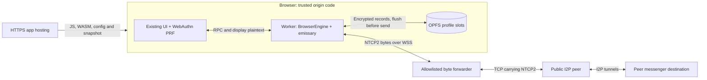

# Browser messenger

The browser entry is `ui/browser.html`. It uses the existing Gipny screens with
a Dedicated Worker and a Rust WASM core. It does not pair with a native client.
The feature is under review in [PR #144](https://github.com/gluckdev/gipny-i2p/pull/144).
The live messenger acceptance run must pass before this is treated as ready.

## Runtime and storage

The worker runs the pinned emissary client router and an in-process streaming
destination. Its default exploratory and client pools each use two-hop paths.
There are no SAM/I2CP TCP listeners and no transit service. NTCP2 remains
encrypted between the browser router and I2P peers; the WSS forwarder transports
bounded byte streams to addresses verified from RouterInfo records.



The origin supplies executable code and is trusted with unlocked data. The
forwarder carries encrypted NTCP2 but observes browser IPs, timing and volume.

The Rust core owns the messenger identity, signed/one-time prekeys, destination
private keys and ratchet state. X3DH, Double Ratchet, message padding and native
relay/message formats are shared with `libcore`. JavaScript receives public
identity information and the plaintext needed to display conversations.

Profiles use OPFS in a worker, exclusive sync handles and a Web Lock. Two slots
alternate encrypted records. XChaCha20-Poly1305 authenticates contents and record
headers; a separate checksum detects incomplete writes. The newest complete
record is selected before checking credentials. A successful password change
flushes the new credential wrapper to both live slots; an old wrapper is not
left in the recovery slot. Previously copied profiles retain their own password
wrappers. File I/O errors are surfaced.
Profile labels and credential descriptors are available before unlock; they are
not encrypted conversation data. Password salts and wrapped-key headers are
public format metadata, while private keys and conversation state are encrypted.

Password wrapping uses Argon2id with 64 MiB, three iterations and one lane.
Passkeys are enrolled only when WebAuthn returns a real 32-byte PRF result.
Credential signatures and IDs are never substituted for the encryption secret.
Keep the password as a recovery method when an authenticator is unavailable.

An outgoing ratchet advance and its exact ciphertext outbox entry are encrypted,
written and flushed before sending. Incoming messages and receipts are flushed
before acknowledging the deposit. A failed write stops the profile and requires
reopening it; the old ratchet is never reused after an ambiguous write.

Transport recovery preserves the newest signed LeaseSet publication and tracks
the peer's encryption key independently of the application's ratchet. I2P uses
the one-second `published` field to version LeaseSet2 records; a LeaseSet2
contains the destination's currently authorized leases.
See the [I2P structure specification](https://i2p.net/en/docs/specs/common-structures/#leaseset2header).

Expired history is pruned while the profile is open and when it is reopened.
Local history/group removal discards unprepared letters and removes their
plaintext retry payloads. Already prepared ciphertext remains queued so that
removing history cannot break the ratchet chain. Successful credential changes
and logical erasure replace both live OPFS slots. This does not erase previously
copied backups or guarantee physical removal from the browser's storage media.

Locking stops the network, closes storage and terminates the worker. Navigation
and page freeze also terminate it. Returning to a retained page reloads the
locked UI. An offline service worker caches the application shell and generated
WASM/worker assets, excluding network configuration, snapshots and profile data.
Updates wait for old application windows to close.

Browser memory does not provide the native client's `mlock`/`mprotect` boundary.
Rust secret buffers are zeroized when released; JavaScript plaintext and the
browser's own memory/storage lifecycle have different guarantees. OPFS remains
subject to browser quota and site-data removal.

## Validation and artifacts

All builds and test execution run in GitHub Actions. The `Browser router WASM`
workflow builds `ui/browser-dist` after generating the WASM package and uploads
`browser-messenger-pwa`. Its native integration job obtains a fresh verified
netDb snapshot, then runs two Chrome processes with independent data directories.

`browser-router/tests/run_messenger_ci.py` checks actual production worker RPC,
WebAuthn PRF with a virtual CTAP2 authenticator, two live client destinations,
bidirectional encrypted messages, delivery receipts, an inline attachment and
worker restart with restored identity/destination/history/ratchet and offline
outbox retry. Public receipts are uploaded separately. Passwords, capabilities,
CDP traffic and private browser directories are excluded from artifacts.

The shared crypto/codec tests also check tampering, identity pinning, replay,
out-of-order messages and fixed-integer bincode compatibility. Vault tests check
wrong credentials, password rotation, passkey wrapping and torn-slot recovery.
An emulated or virtual authenticator test is not physical mobile validation.

Latest completed run: `bee4456`,
[41326667198](https://github.com/gluckdev/gipny-i2p/actions/runs/41326667198).
The three recovery regressions, all 89 native session tests, 46 WASM tests,
real NTCP2 and both cold bootstrap profiles passed (180.31 / 88.47 s from
navigation to ready, 32 / 31 s held, 5 / 3 roundtrips, 153 verified RouterInfo
records). All native platform/build checks and CodeQL passed. Live bidirectional
messages, receipts, attachment name and bytes, and PRF passed. The next blocked
contact mailbox deposit timed out after 120 s, before restart or offline-shell
checks. The sender reported `CANT_REACH_PEER`, three rejected SYN handshakes
and one newer LeaseSet lookup while both clients still had active tunnels.

The implementation now probes known contact relays with bounded authenticated
Ping/Pong streams after network recovery. It does not send chat text or advance
the application's ratchet. The inbound-first path records the peer's signed
LeaseSet encryption key so that a later key change retires the old ECIES
session. These changes passed the native regressions but have not yet resolved
live restart delivery.

The `bee4456` fix preserves a newer signed LeaseSet/key learned from inbound
traffic when an older lookup or garlic record arrives. Its regressions check
that delayed older records cannot roll back the cached route or destroy the
restarted session. That run did not reach the live restart assertion.

The following route-cache fix treats an accepted LeaseSet as a complete set:
superseded inbound tunnels are removed from existing and new routing handles,
and repeated identical lookups preserve known failure status. Native tests
cover those transitions and duplicate-cache prevention; the complete routing
path module is added to CI. This change awaits its first CI result.
Full live acceptance remains pending.

The `bee4456` WASM/PWA job passed. Its
[`browser-messenger-pwa` ZIP](https://github.com/gluckdev/gipny-i2p/actions/runs/41326667198/artifacts/13091328428)
is 1,982,419 bytes; GitHub artifact SHA256:
`f475d09eac0463865339ee0a3e5872c9da0793b7368c64b08e536744d59791e4`.
The verified emissary patch SHA256 is
`6567de72b7cb79894bc802d1b3a68efb54699a49e122231ac96c8863c1c627a9`.
These identify that compiled artifact and source patch; the failed live job
remains a separate acceptance gate.

Earlier run `3e0ab82`,
[41322770968](https://github.com/gluckdev/gipny-i2p/actions/runs/41322770968),
passed the three recovery regressions, all 89 native session tests, 46 WASM
tests and both cold profiles. Live restart delivery timed out after 180 s.
Numeric diagnostics showed two encryption-key changes at the sender, repeated
non-newer lookup results and failed probes from the restored recipient.

Earlier run `b93fdc7`,
[41317354451](https://github.com/gluckdev/gipny-i2p/actions/runs/41317354451),
passed both native recovery regressions and all 46 WASM tests. Desktop and
constrained cold bootstrap passed (162.31 / 178.52 s to ready, 32 / 33 s held,
3 / 5 roundtrips, 157 verified RouterInfo records). Live bidirectional messages,
receipts, PRF, blocking and restored identity/address passed. Restart delivery
timed out after 180 s with six sender `DialFailure` errors.

The earlier intermediate `e6709dd` run passed all 46 WASM tests, but stopped at the new
native regression: its initial empty-queue assertion mistook local-destination
registration for a remote lookup. That assertion is corrected in source.
The follow-up also resets stale I2P ECIES sessions when the signed LeaseSet
encryption key changes and checks decryption by a restarted recipient. These
changes were subsequently checked in the later runs above; the stopped run
itself provided no new live result.

Earlier live evidence: `f72d7f4`, 2026-11-01,
[Actions run 41309131811](https://github.com/gluckdev/gipny-i2p/actions/runs/41309131811).

| Check | Result |
|---|---|
| Release PWA/WASM, UI tests and typecheck | PASS |
| WASM tests | 46/46 PASS, including 9/9 engine tests |
| Native fast/security matrix, build and CodeQL | PASS |
| Live destinations, bidirectional messages, receipts and attachment | PASS in two independent Chrome processes |
| Actual WebAuthn PRF helper with virtual CTAP2 authenticator | PASS |
| Blocked contact and unblocking exact-ciphertext retry | PASS |
| Password rotation, both-slot wrappers, old-password rejection and restored identity/address | Passed before the later delivery timeout |
| Delivery after recipient restart | FAILED: pending message did not arrive within 180 s after the restored destination became ready |
| Cold desktop / constrained bootstrap | Desktop PASS (230.29 s to ready, 32 s held, 3 roundtrips); constrained FAILED (no inbound tunnel by deadline) |
| Offline shell with HTTP server stopped | Not reached |
| Physical devices / public deployment | Not performed |

The recovery implementation refreshes a cached remote LeaseSet after a failed streaming
handshake. A peer can restart on the same destination keys with different
inbound tunnels while its previous LeaseSet is still unexpired. This source
change passed its native regression in later runs; full live acceptance remains open.
Failed refresh queries also keep the cache marked stale until a valid lookup
succeeds, rather than immediately reusing the old unexpired address.

Earlier baseline: `bb0578e`, 2026-11-01:

| Check | Result |
|---|---|
| Release WASM, production PWA and UI tests | PASS |
| WASM tests in Chrome | 45/45 PASS, including 9/9 BrowserEngine tests |
| Real NTCP2 handshakes | PASS |
| Cold bootstrap, desktop | PASS: 50.28 s from navigation, 33 s sustained availability, 5 roundtrips |
| Cold bootstrap, constrained Chrome | PASS: 34.35 s, 33 s sustained availability, 3 roundtrips; 4× CPU slowdown, 80 ms latency, 200/100 KiB/s down/up |
| Two independent browser messengers | FAILED during startup: lower-level snapshot URL validation rejected `localhost`; corrected and confirmed by later live runs above |
| Physical phones and public deployment | Not performed |

Source: [Actions run 41306799095](https://github.com/gluckdev/gipny-i2p/actions/runs/41306799095).
Both cold probes used a fresh snapshot with 175 verified RouterInfo records.
The loadable module contained 3,165,432 bytes WASM and 62,471 bytes JS.
The `browser-messenger-pwa` artifact ZIP was 1,977,472 bytes with SHA256
`b85c623f7abf16ce7f34eb06fda20676a334866ecb2462ff978b234f9e415546`.
These are measurements of that commit, not promises for every network or device.
The earlier constrained run at `e22a800` timed out; live I2P startup varies.
The successful WASM job does not make the failed integration workflow green.
Router-only bootstrap memory figures exclude the 64 MiB password-KDF workspace
and unlocked conversation state. They are not measurements of full messenger RAM.

The acceptance scenario must also reach offline history after stopping the HTTP
server. A partly successful run does not confirm that final phase. Later commits
must be checked against their own runs.

### Recovery diagnostics

On failure, `browser-messenger-evidence/receipt.json` includes bounded transport
status strings and `network_metrics` for the two clients, in Alice/Bob order.
The `browser_diagnostics` worker RPC returns numeric counters/gauges and
`relay_probes` totals; it does not return destination identifiers, message
contents, credentials or keys. Router counters reset when a new runtime starts.

| Signal | Meaning |
|---|---|
| `client_lease_refresh_requested`, `client_lease_query_success`, `client_lease_query_failure` | Forced refresh requests and completed lookup outcomes |
| `client_newer_lease_received`, `client_unchanged_lease_received` | Accepted lookup publication compared with the cached record; a discarded older reply is counted as unchanged |
| `client_stale_lease_query_ignored`, `client_stale_garlic_lease_ignored`, `client_stale_encryption_key_ignored` | An older signed publication was prevented from replacing newer state |
| `client_lease_encryption_key_changed` | A changed peer transport key caused old ECIES sessions/tags to be retired; application ratchets are separate |
| `client_stream_syn_rejected` | Streaming SYN retries were exhausted before the stream opened |
| `client_selected_lease_missing` | A selected route referenced an inbound tunnel absent from the destination cache |
| `relay_probes.attempted/completed/failed` | Authenticated Ping/Pong attempts to known contacts after network startup |

`CANT_REACH_PEER` identifies a failed stream handshake, not successful envelope
delivery. A successful lookup or an existing tunnel alone does not establish
that a restarted contact is reachable. Diagnose these together with the exact
failed assertion; do not treat a counter as proof of a root cause.

## Hosting preparation

Serve the artifact over HTTPS with `application/wasm` for `.wasm`, no third-party
scripts, `X-Content-Type-Options: nosniff`, `Referrer-Policy: no-referrer` and
`X-Frame-Options: DENY`. Use `/browser.html` as the start page. Preserve the CSP in
the HTML and its `wasm-unsafe-eval` permission. Hosting under a subpath requires
building with the corresponding `VITE_BASE` in GitHub Actions.

Provide an uncached `browser-config.json` beside `browser.html`:

```json
{
  "snapshot_url": "https://chat.example.org/snapshot.tar.gz",
  "snapshot_sha256": "<SHA256 from the snapshot manifest>",
  "forwarder_url": "wss://forwarder.example.org:8443/stream",
  "capability": "<43-character unpadded base64url token>"
}
```

The capability is visible to the browser. It is a forwarder protocol boundary,
not a profile password or protection against a malicious client that knows it.
The forwarder still enforces exact Host/Origin, verified public IPv4 targets,
freshness, connection/rate/byte/time limits and TLS. Never enable handshake debug
logging or arbitrary target registration.

A matching TLS forwarder command, using separately supplied certificates and a
verified `candidates.tsv`, is:

```sh
python3 browser-router/forwarder/server.py \
  --listen 0.0.0.0:8443 \
  --host forwarder.example.org:8443 \
  --origin https://chat.example.org \
  --capability-file /run/gipny/forwarder-capability \
  --candidates /srv/gipny/candidates.tsv \
  --tls-cert /run/gipny/fullchain.pem \
  --tls-key /run/gipny/privkey.pem \
  --max-connections 32 --session-seconds 600 --idle-seconds 120 \
  --max-bytes 67108864
```

Snapshot generation uses `collect-netdb` and `prepare-netdb`, built in GitHub
Actions with `native-peer`. The packer records the actual committed i2pd pin and
refuses a mismatching checkout. Publish the snapshot, its SHA256 configuration
and the corresponding allowlist together. The current forwarder loads its
allowlist at startup; refreshing it requires a controlled restart. Expired
RouterInfo targets are rejected. A stale allowlist is not a permanent service.

A public server/domain, certificate access and physical mobile browsers still
need to be supplied for deployment and device acceptance. This branch prepares
the code and artifacts; it does not publish a public service.
The older [`scripts/deploy` templates](../scripts/deploy/README.md) describe a
server-side `gipny-web` gateway and do not deploy this browser architecture.

## Physical-device acceptance

This procedure has not yet been run on physical phones. Use test profiles and
the exact PWA artifact/commit under review, served by the HTTPS/WSS setup above.
Record device model, OS/browser versions, artifact commit and each result.

1. Create independent profiles on the phone and a second browser. Record cold
   navigation-to-ready time, including profile unlock and client tunnel startup.
   Compare identity fingerprints through a trusted channel and exchange cards.
2. Send messages both ways, a reply and a small attachment. Check the receiver's
   contents and the sender's end-to-end Delivered status.
3. Enroll a passkey where the authenticator provides PRF; lock and unlock with
   it. If PRF is unavailable, record that result and check password fallback.
   Change the password, restart the app and check that the old password fails.
4. Close the receiving app, queue a message from the sender, then reopen it.
   Check unchanged identity/address, recovered history, eventual delivery and
   absence of duplicate messages. Repeat after phone sleep and a Wi-Fi/mobile
   network transition. Record recovery time separately from initial startup.
5. After the shell has been cached, disable connectivity and reopen the app
   from its installed icon or start URL. Unlock and read saved history. Restore
   connectivity and check reconnection and pending delivery.
6. Install the PWA where offered. Check navigation, lock/reopen and return from
   background in installed mode as well as a normal tab.

Retain public pass/fail results and timings. Passwords, PRF output, capability
tokens, private browser directories and protocol dumps are not acceptance
artifacts. A successful desktop emulation does not complete these device checks.

The first browser transport supports direct messages, group fanout and inline
attachments up to 1 MiB per message within a 16 MiB encrypted profile. Native
console/agent execution, large multipart file transfer, DHT discovery, transit,
Yggdrasil, native installers, destructive attempt counters and duress profiles
require separate browser implementations. Unsupported commands return errors.
