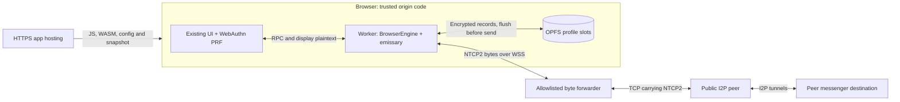

# Browser messenger

The browser entry is `ui/browser.html`. It uses the existing Gipny screens with
a Dedicated Worker and a Rust WASM core. It does not pair with a native client.
The feature is under review in [PR #144](https://github.com/gluckdev/gipny-i2p/pull/144).
The live messenger acceptance run must pass before this is treated as ready.

## Runtime and storage

The worker runs the pinned emissary client router and an in-process streaming
destination. Its default exploratory and client pools each use two-hop paths.
There are no SAM/I2CP TCP listeners and no transit service. NTCP2 remains
encrypted between the browser router and I2P peers; the WSS forwarder transports
bounded byte streams to addresses verified from RouterInfo records.



The origin supplies executable code and is trusted with unlocked data. The
forwarder carries encrypted NTCP2 but observes browser IPs, timing and volume.

The Rust core owns the messenger identity, signed/one-time prekeys, destination
private keys and ratchet state. X3DH, Double Ratchet, message padding and native
relay/message formats are shared with `libcore`. JavaScript receives public
identity information and the plaintext needed to display conversations.

Profiles use OPFS in a worker, exclusive sync handles and a Web Lock. Two slots
alternate encrypted records. XChaCha20-Poly1305 authenticates contents and record
headers; a separate checksum detects incomplete writes. The newest complete
record is selected before checking credentials. A successful password change
flushes the new credential wrapper to both live slots; an old wrapper is not
left in the recovery slot. Previously copied profiles retain their own password
wrappers. File I/O errors are surfaced.

Password wrapping uses Argon2id with 64 MiB, three iterations and one lane.
Passkeys are enrolled only when WebAuthn returns a real 32-byte PRF result.
Credential signatures and IDs are never substituted for the encryption secret.
Keep the password as a recovery method when an authenticator is unavailable.

An outgoing ratchet advance and its exact ciphertext outbox entry are encrypted,
written and flushed before sending. Incoming messages and receipts are flushed
before acknowledging the deposit. A failed write stops the profile and requires
reopening it; the old ratchet is never reused after an ambiguous write.

Expired history is pruned while the profile is open and when it is reopened.
Local history/group removal discards unprepared letters and removes their
plaintext retry payloads. Already prepared ciphertext remains queued so that
removing history cannot break the ratchet chain. Successful credential changes
and logical erasure replace both live OPFS slots. This does not erase previously
copied backups or guarantee physical removal from the browser's storage media.

Locking stops the network, closes storage and terminates the worker. Navigation
and page freeze also terminate it. Returning to a retained page reloads the
locked UI. An offline service worker caches the application shell and generated
WASM/worker assets, excluding network configuration, snapshots and profile data.
Updates wait for old application windows to close.

Browser memory does not provide the native client's `mlock`/`mprotect` boundary.
Rust secret buffers are zeroized when released; JavaScript plaintext and the
browser's own memory/storage lifecycle have different guarantees. OPFS remains
subject to browser quota and site-data removal.

## Validation and artifacts

All builds and test execution run in GitHub Actions. The `Browser router WASM`
workflow builds `ui/browser-dist` after generating the WASM package and uploads
`browser-messenger-pwa`. Its native integration job obtains a fresh verified
netDb snapshot, then runs two Chrome processes with independent data directories.

`browser-router/tests/run_messenger_ci.py` checks actual production worker RPC,
WebAuthn PRF with a virtual CTAP2 authenticator, two live client destinations,
bidirectional encrypted messages, delivery receipts, an inline attachment and
worker restart with restored identity/destination/history/ratchet and offline
outbox retry. Public receipts are uploaded separately. Passwords, capabilities,
CDP traffic and private browser directories are excluded from artifacts.

The shared crypto/codec tests also check tampering, identity pinning, replay,
out-of-order messages and fixed-integer bincode compatibility. Vault tests check
wrong credentials, password rotation, passkey wrapping and torn-slot recovery.
An emulated or virtual authenticator test is not physical mobile validation.

Latest completed evidence: `f72d7f4`, 2026-11-01,
[Actions run 41309131811](https://github.com/gluckdev/gipny-i2p/actions/runs/41309131811).

| Check | Result |
|---|---|
| Release PWA/WASM, UI tests and typecheck | PASS |
| WASM tests | 46/46 PASS, including 9/9 engine tests |
| Native fast/security matrix, build and CodeQL | PASS |
| Live destinations, bidirectional messages, receipts and attachment | PASS in two independent Chrome processes |
| Actual WebAuthn PRF helper with virtual CTAP2 authenticator | PASS |
| Blocked contact and unblocking exact-ciphertext retry | PASS |
| Password rotation, both-slot wrappers, old-password rejection and restored identity/address | Passed before the later delivery timeout |
| Delivery after recipient restart | FAILED: pending message did not arrive within 180 s after the restored destination became ready |
| Cold desktop / constrained bootstrap | Desktop PASS (230.29 s to ready, 32 s held, 3 roundtrips); constrained FAILED (no inbound tunnel by deadline) |
| Offline shell with HTTP server stopped | Not reached |
| Physical devices / public deployment | Not performed |

The restart fix now refreshes a cached remote LeaseSet after a failed streaming
handshake. A peer can restart on the same destination keys with different
inbound tunnels while its previous LeaseSet is still unexpired. This source
change and its CI regression await a new run; the full acceptance remains open.

Earlier baseline: `bb0578e`, 2026-11-01:

| Check | Result |
|---|---|
| Release WASM, production PWA and UI tests | PASS |
| WASM tests in Chrome | 45/45 PASS, including 9/9 BrowserEngine tests |
| Real NTCP2 handshakes | PASS |
| Cold bootstrap, desktop | PASS: 50.28 s from navigation, 33 s sustained availability, 5 roundtrips |
| Cold bootstrap, constrained Chrome | PASS: 34.35 s, 33 s sustained availability, 3 roundtrips; 4× CPU slowdown, 80 ms latency, 200/100 KiB/s down/up |
| Two independent browser messengers | FAILED during startup: lower-level snapshot URL validation rejected `localhost`; corrected in source, rerun pending |
| Physical phones and public deployment | Not performed |

Source: [Actions run 41306799095](https://github.com/gluckdev/gipny-i2p/actions/runs/41306799095).
Both cold probes used a fresh snapshot with 175 verified RouterInfo records.
The loadable module contained 3,165,432 bytes WASM and 62,471 bytes JS.
The `browser-messenger-pwa` artifact ZIP was 1,977,472 bytes with SHA256
`b85c623f7abf16ce7f34eb06fda20676a334866ecb2462ff978b234f9e415546`.
These are measurements of that commit, not promises for every network or device.
The earlier constrained run at `e22a800` timed out; live I2P startup varies.
The successful WASM job does not make the failed integration workflow green.
Router-only bootstrap memory figures exclude the 64 MiB password-KDF workspace
and unlocked conversation state. They are not measurements of full messenger RAM.

The acceptance scenario must also reach offline history after stopping the HTTP
server. A partly successful run does not confirm that final phase. Later commits
must be checked against their own runs.

## Hosting preparation

Serve the artifact over HTTPS with `application/wasm` for `.wasm`, no third-party
scripts, `X-Content-Type-Options: nosniff`, `Referrer-Policy: no-referrer` and
`X-Frame-Options: DENY`. Use `/browser.html` as the start page. Preserve the CSP in
the HTML and its `wasm-unsafe-eval` permission. Hosting under a subpath requires
building with the corresponding `VITE_BASE` in GitHub Actions.

Provide an uncached `browser-config.json` beside `browser.html`:

```json
{
  "snapshot_url": "https://chat.example.org/snapshot.tar.gz",
  "snapshot_sha256": "<SHA256 from the snapshot manifest>",
  "forwarder_url": "wss://forwarder.example.org:8443/stream",
  "capability": "<43-character unpadded base64url token>"
}
```

The capability is visible to the browser. It is a forwarder protocol boundary,
not a profile password or protection against a malicious client that knows it.
The forwarder still enforces exact Host/Origin, verified public IPv4 targets,
freshness, connection/rate/byte/time limits and TLS. Never enable handshake debug
logging or arbitrary target registration.

A matching TLS forwarder command, using separately supplied certificates and a
verified `candidates.tsv`, is:

```sh
python3 browser-router/forwarder/server.py \
  --listen 0.0.0.0:8443 \
  --host forwarder.example.org:8443 \
  --origin https://chat.example.org \
  --capability-file /run/gipny/forwarder-capability \
  --candidates /srv/gipny/candidates.tsv \
  --tls-cert /run/gipny/fullchain.pem \
  --tls-key /run/gipny/privkey.pem \
  --max-connections 32 --session-seconds 600 --idle-seconds 120 \
  --max-bytes 67108864
```

Snapshot generation uses `collect-netdb` and `prepare-netdb`, built in GitHub
Actions with `native-peer`. The packer records the actual committed i2pd pin and
refuses a mismatching checkout. Publish the snapshot, its SHA256 configuration
and the corresponding allowlist together. The current forwarder loads its
allowlist at startup; refreshing it requires a controlled restart. Expired
RouterInfo targets are rejected. A stale allowlist is not a permanent service.

A public server/domain, certificate access and physical mobile browsers still
need to be supplied for deployment and device acceptance. This branch prepares
the code and artifacts; it does not publish a public service.
The older [`scripts/deploy` templates](../scripts/deploy/README.md) describe a
server-side `gipny-web` gateway and do not deploy this browser architecture.

The first browser transport supports direct messages, group fanout and inline
attachments up to 1 MiB per message within a 16 MiB encrypted profile. Native
console/agent execution, large multipart file transfer, DHT discovery, transit,
Yggdrasil, native installers, destructive attempt counters and duress profiles
require separate browser implementations. Unsupported commands return errors.
